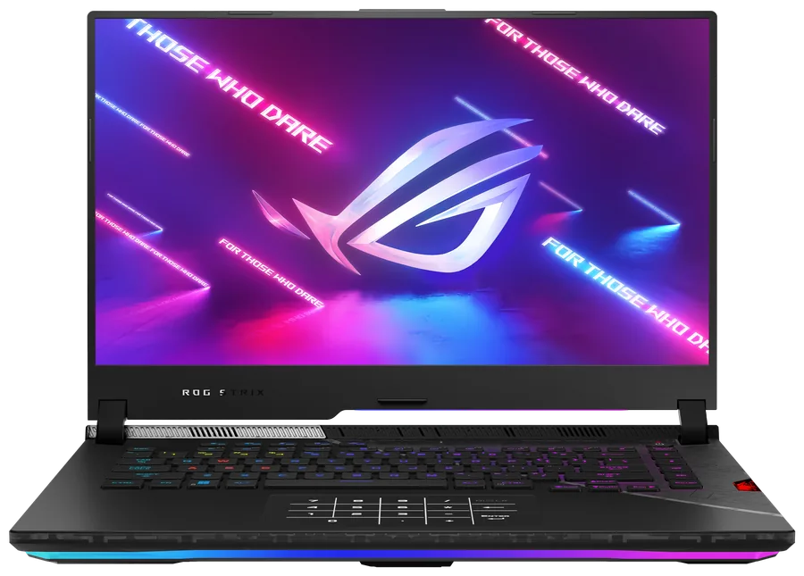
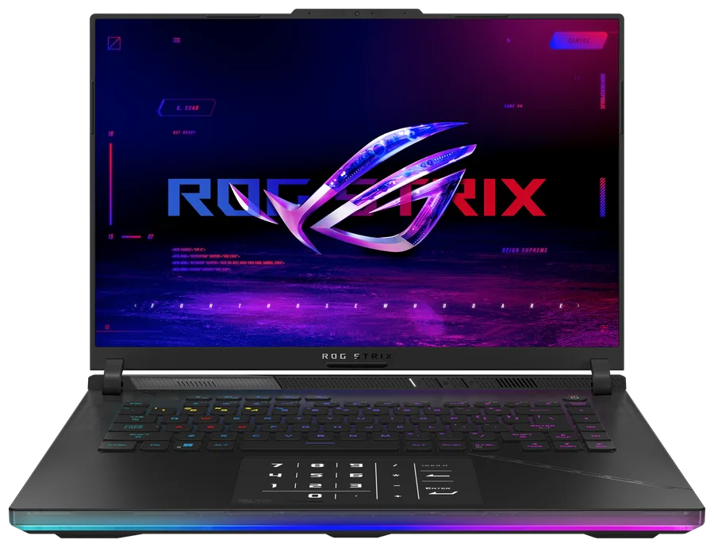
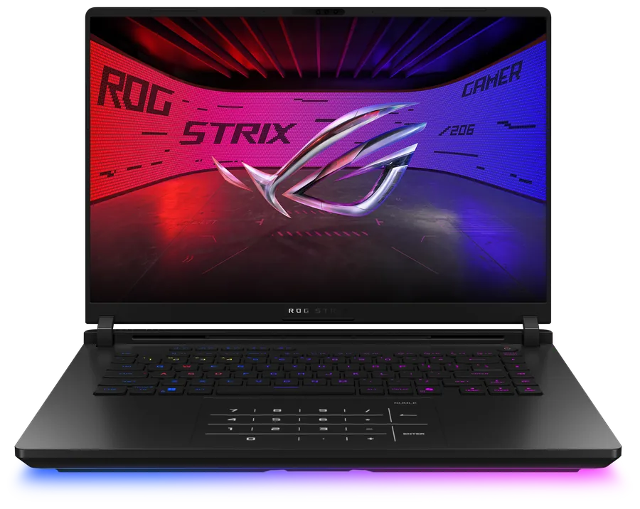
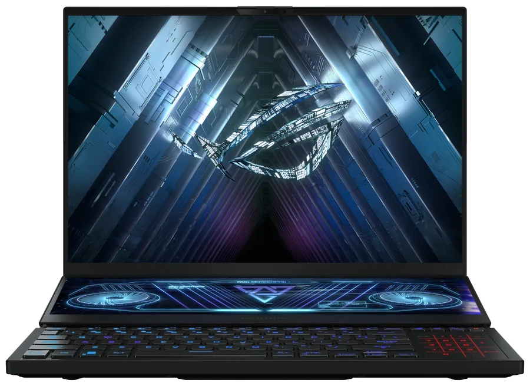

# asus-numpad

English · [简体中文](README.zh-CN.md) · [繁體中文](README.zh-TW.md) · [Website](https://asus-numpad.github.io/)

Linux userspace driver for the ASUS NumberPad. The touchpad is grabbed through evdev, contacts
are mapped to numpad cells, key events are injected through uinput. No kernel module is replaced,
no ACPI table is patched; uninstalling restores stock behaviour.

Timing and geometry constants come from `AlgoParameters` in the vendor file `AsusNUMPADFilter.inf`.

## Installation

```bash
# Debian / Ubuntu
sudo install -d -m 0755 /usr/share/keyrings
curl -fsSL https://raw.githubusercontent.com/asus-numpad/asus-numpad/main/repo/keys/asus-numpad-repo.gpg \
  | sudo tee /usr/share/keyrings/asus-numpad.gpg >/dev/null
echo "deb [signed-by=/usr/share/keyrings/asus-numpad.gpg] https://raw.githubusercontent.com/asus-numpad/asus-numpad/main/repo/apt stable main" \
  | sudo tee /etc/apt/sources.list.d/asus-numpad.list
sudo apt update && sudo apt install asus-numpad

# Fedora / RHEL / Rocky / Alma
sudo rpm --import https://raw.githubusercontent.com/asus-numpad/asus-numpad/main/repo/keys/asus-numpad-repo.asc
sudo tee /etc/yum.repos.d/asus-numpad.repo >/dev/null <<'EOF'
[asus-numpad]
name=asus-numpad
baseurl=https://raw.githubusercontent.com/asus-numpad/asus-numpad/main/repo/rpm/$basearch
enabled=1
gpgcheck=1
repo_gpgcheck=1
gpgkey=https://raw.githubusercontent.com/asus-numpad/asus-numpad/main/repo/keys/asus-numpad-repo.asc
EOF
sudo dnf install asus-numpad

# openSUSE Leap / Tumbleweed, same rpm-md repo, zypper reads it directly
sudo rpm --import https://raw.githubusercontent.com/asus-numpad/asus-numpad/main/repo/keys/asus-numpad-repo.asc
sudo zypper addrepo --refresh \
  "https://raw.githubusercontent.com/asus-numpad/asus-numpad/main/repo/rpm/$(uname -m)" asus-numpad
sudo zypper install asus-numpad

# Arch / Manjaro
curl -fsSL https://raw.githubusercontent.com/asus-numpad/asus-numpad/main/repo/keys/asus-numpad-repo.asc -o /tmp/asus-numpad.asc
sudo pacman-key --add /tmp/asus-numpad.asc
sudo pacman-key --lsign-key 79F282157F2D3FF8E3C6806314C2BF611986E168
sudo tee -a /etc/pacman.conf >/dev/null <<'EOF'

[asus-numpad]
SigLevel = Required DatabaseRequired
Server = https://raw.githubusercontent.com/asus-numpad/asus-numpad/main/repo/arch/$arch
EOF
sudo pacman -Syu asus-numpad

# Alpine
curl -fsSL https://raw.githubusercontent.com/asus-numpad/asus-numpad/main/repo/keys/asus-numpad-apk.rsa.pub \
  | sudo tee /etc/apk/keys/asus-numpad-apk.rsa.pub >/dev/null
echo "https://raw.githubusercontent.com/asus-numpad/asus-numpad/main/repo/alpine/$(apk --print-arch)" | sudo tee -a /etc/apk/repositories
sudo apk update && sudo apk add asus-numpad
```

One package per ecosystem. The deb is built on Ubuntu 22.04 and covers 22.04 to 24.04 plus Debian
12 and 13. The rpm is built on AlmaLinux 9 and covers RHEL, AlmaLinux, Rocky 9 to 10, Fedora,
openSUSE Leap 16 and Tumbleweed: the spec uses standard macros only, runtime dependencies are glibc
and systemd, and the repository is rpm-md, which zypper reads directly. Nothing is rebuilt per
distribution. Native packages are also on
[Releases](https://github.com/asus-numpad/asus-numpad/releases): deb, rpm, pkg.tar.zst, PKGBUILD with
.SRCINFO, apk, static tarball. Building the PKGBUILD by hand: put `PKGBUILD` and
`asus-numpad-rs.install` in one directory and run `makepkg -si`. Alpine, Gentoo, NixOS and manual
tarball steps are in [docs/install.md](docs/install.md). The repositories and the release assets are
x86_64 only; other architectures need a local build.

`ci.yml` builds a package per ecosystem on every push and checks the package metadata. `release.yml`
additionally installs each package in a clean container of every target distribution and runs
`asus-numpad --version`; a package that does not install blocks the release.

Runtime model detection means a package is never tied to one model: the same binary reads the DMI
fields and the touchpad module, then picks the matching parameter set and keymap. A machine that
matches no row of the table is not started: the gate exits with code 3 and prints the supported
models, rather than running parameters meant for other hardware. If the hardware cannot be read
reliably (virtual machines, whitebox chassis, BIOS placeholder strings), pin the model by hand, see
[Model detection](#model-detection). Runtime dependency: glibc, or musl on Alpine.

## Usage

```bash
asus-numpad check          # read-only self test: devices, layout conversion, backlight candidates
asus-numpad dump           # raw event stream
asus-numpad run            # foreground, started by the systemd unit
asus-numpad --dump-config  # effective configuration
```

```bash
asus-numpad bright 0..N         # step, 0 = off (follow disabled); N is the step count (4 by default)
asus-numpad bright up|down|cycle
asus-numpad bright follow on|off
asus-numpad bright status
```

```bash
asus-numpad levels              # step table: the byte each step writes
asus-numpad levels 2 0x46       # step 2 writes 0x46 (0x00 or 0x41..0x48)
asus-numpad levels reset        # back to the default four steps
asus-numpad led on|off|0x41     # bypass the state machine, send one backlight byte
asus-numpad layout              # keymap in use, every recorded keymap, support level
asus-numpad layout --ids        # module name to keymap table
asus-numpad layout auto         # back to automatic selection
```

```bash
asus-numpad lang [zh-CN|zh-TW|en|auto]
asus-numpad --lang en check     # this invocation only
```

Language precedence: `ASUS_NUMPAD_LANG`, `--lang`, `language` in the config, system locale.

## Configuration

`~/.config/asus-numpad/asus-numpad.json`, or `/etc/asus-numpad/` when run by root. Unwritten keys
use vendor defaults.

| Key | Value | Meaning |
| --- | --- | --- |
| `numlock` | `sync` / `toggle` / `off` | Follow the system NumLock state |
| `calc_gesture` | `true` / `false` | Gesture launches the calculator |
| `calc_gesture_mode` | `long` / `off` | Trigger type |
| `mixed_mode` | `auto` / `on` / `off` | `auto` keeps the pointer only for two-finger gestures while the pad is lit; `on` always passes touches outside the key grid to the desktop; `off` = keys only. `auto` / `on` need `/dev/uinput` |
| `grab` | `true` / `false` | Grab the touchpad; when off, clicks reach the desktop |
| `led_kind` | `auto` / `hidraw` / `i2c` / `none` | Backlight channel |
| `follow_keyboard_brightness` | `true` / `false` | Mirror the keyboard backlight, default `true` |
| `manual_brightness_step` | `0`..`3` | Current manual step (0 = off), used when follow is off; the range ends at the step count |
| `manual_brightness_levels` | array | Step to value table, default `[0, 0x43, 0x45, 0x48]`; entries `0` or `0x41`..`0x48`; length 1 to 8 sets the step count; equal neighbours allowed; a decreasing table is discarded |
| `brightness_levels` | array | Hardware steps, default `0x41`..`0x48` |
| `brightness_poll_ms` | ms | Poll interval, default `500` |
| `allow_unverified_layout` | `true` / `false` | Accept an unlisted layout of a known family |
| `layout_name` | keymap name / `auto` | Pin a keymap by name, `auto` selects it from the module |
| `sku` | model id / `null` | Pin a model and skip detection; `null` means auto |

## Supported models

| Model id | Models and model year | DMI prefixes | Touchpad module | Keymap | Configurations without the hardware |
| --- | --- | --- | --- | --- | --- |
| `g533` | Strix SCAR 15 / Strix G15, 15", 2022 | prefix `G533*`, `G513*` — 2021 `G533Q*` / `G513Q*` / `G513I*` excluded | `ASUE1403`, `ELAN1403` | `GH2XLNDZ` | 3 of 5 Strix G15 2022 |
| `g614` | Strix SCAR 16 / Strix G16, 16", 2023–2024 | `G614`, `G634` | `ASUE1416`, `ASUF1416` | `GH3XLNDZ` | 2 of 10 Strix G16 2023 |
| `g615` | Strix SCAR 16 / Strix G16, 16", 2025–2026 | `G615`, `G635` | `ASCP1400`, `ASCF1400` | `GH4XLNDZ` | 1 of 25 Strix G16 2025 |
| `gx550` | Zephyrus Duo 15 / Duo 15 SE / Duo 16, side-mounted, 15"–16", 2020–2023 | `GX550`, `GX551`, `GX650` | `ASUE1408`, `ASUE1404` | `GVM_A`, `GVM` | none in the official lists |
| `ux582` | Zenbook Duo 14 / Zenbook Pro Duo 15 OLED, side-mounted, 14"–15", 2020–2021 | `UX582`, `UX482` | `ASUE1406`, `ELAN1406` | `NVM` | not verified per configuration |

The `GVM_A` / `GVM` / `NVM` parameters are copied verbatim from the official filter, which lists fewer
entries than a full 15-cell table holds: `GVM` ends at `_06`, `NVM` at `_12`. The gaps are written as
`0`, the default the Windows driver reads when an entry is absent; no value is inferred. `GVM_A` shares
the `GVM` values — `NUMPADLAYOUT_GVM_05` / `_06` are annotated "for GVMA" in the filter. Both rows
carry `LayoutSupport::Family`: 5 columns, same grid, never checked key by key on real hardware, so they
are refused at startup unless `--allow-unverified` is given.

This table is the support list: a model id switches parameters by hand (`asus-numpad sku <id>`) and
makes the detection result visible, and a machine outside the table is refused at startup. `G614` and `G634` cover the
2023 and 2024 model years (SCAR 16 -> SCAR 16 2024), `G615` and `G635` cover 2025 and 2026 (Strix
G16 2025 -> 2026 and SCAR 16 2025 -> 2026; `G615` is the standard model, `G635` the SCAR variant):
the trailing characters track CPU refreshes, the touchpad does not change. 2026 keeps the same codes,
so the table needs no extra row. A row is assigned from touchpad module data and keymap tables rather
than validated machine by machine; per-model compatibility lives on the
[website](https://asus-numpad.github.io/).

A model id is not proof that the machine carries the hardware. Some retail configurations of the
same model ship a 4-zone RGB touchpad with no NumberPad while keeping an identical DMI prefix
(`G614JV…-0EAGX…` has it, `G614JV…-0EACX…` does not; counts per generation in the table above). The
keymap therefore still follows the touchpad module, never the model code; the per-configuration check
is in [docs/machines.md](docs/machines.md#同一型号不是都有-numpad按配置核验).

The Zephyrus M16 / G16 / Flow X16 line (幻16 in China; `GU603` through `GV601`) is absent by design,
not by omission: every generation lists a plain `Touchpad` in the official keyboard field, so there is
no icon area to drive. The dual-screen `GX650` (冰刃 6 / 7 双屏) does carry the hardware and is served
by `gx550`. Evidence per generation:
[docs/machines.md](docs/machines.md#幻16-系列无-numberpad已核验).

A model row holds the DMI name prefixes of the generation it serves, plus an `excludes` list for
generations that reuse the same code prefix without the hardware. An excluded prefix falls through to
the module check and, when that misses as well, to the same refusal. A manual `sku` pin outranks
both. Prefixes are reused across regional line-ups as well: `G614P*` ships in China as the 2025
Strix (魔霸 10 / 魔霸 9), and the per-configuration counts above do not cover those listings; the
touchpad module still decides the keymap.

The model code in DMI is authoritative; marketing names are for orientation only. The old per-model
package names (`asus-numpad-g614` and friends) stay in `Obsoletes`, so upgrades move to `asus-numpad`.

| | |
| --- | --- |
|  |  |
| SCAR 15 / Strix G15 (2022) | SCAR 16 / Strix G16 (2023) |
|  |  |
| SCAR 16 / Strix G16 (2025) | Zephyrus Duo 16 (GX650, 2022), side-mounted touchpad |

Product images come from the ASUS product pages and are used to identify the model only.

### Dual-screen models: side-mounted touchpad

Status: `GVM` / `GVM_A` / `NVM` carry the official parameters (the entries the filter omits are `0`),
so these two rows are `family`: the grid is the usual 5 columns, but no one has confirmed key positions
on this hardware yet. Startup needs `--allow-unverified`. What follows is the behaviour the driver is
built for.

On the Zephyrus Duo and Zenbook Duo the secondary screen takes half of the palm rest, so the touchpad
is a vertical strip to the right of the keyboard instead of sitting under the palms. Number mode on
these machines is switched by a **dedicated key on the keyboard** (the ScreenPad key on `GX550` is one
of them), not by a long press on the icon area at the top-right corner of the touchpad. The 62-frame
icon-area long press therefore does not apply to a side-mounted pad:

- Contact mapping and backlight are unchanged: cell centres shift with the keymap of that module, and
  the backlight still uses FEATURE `0x0d`.
- The mode switch belongs to the keyboard key. The keyboard is its own HID device and the driver grabs
  the touchpad only, so it never competes for that key.
- To pin number mode, use the `numlock` option (`sync` / `toggle` / `off`) rather than the long press.

### Model detection

Detection uses the union of the DMI fields `product_name`, `board_name` and `product_family`. BIOS
placeholder strings count as missing and do not block startup; a vendor field that is clearly not
ASUS blocks startup.

Touchpad module name (such as `ASUE1416`, read from i2c-hid and HID) is the second signal, used
when DMI names no model. When neither signal names a row, the machine is outside the support list and
the gate refuses to start with exit code 3; `--sku` stays the way in. Module and keymap per model:
[docs/machines.md](docs/machines.md).

When the hardware cannot be read reliably, pin the model:

```bash
asus-numpad sku            # what was detected, and on what evidence
asus-numpad sku list       # available model ids
asus-numpad sku g614       # pin a model, persisted to the config
asus-numpad sku auto       # back to auto-detection
```

`sku` in the config wins over detection; `--sku g614` applies to one invocation only.

### Layout gate

Keymaps are keyed by module name: `HID_LAYOUTS` in `src/layout.rs` maps 44 module names to keymap
names from the vendor INF. Each keymap carries a support level.

| Level | Behaviour |
| --- | --- |
| `verified` | starts as is |
| `family` | same 5x4 grid, official parameters copied in full (entries the INF omits default to `0`), not verified key by key on hardware: refused until allowed |
| `unsupported` | parameters recorded but no key-position reference and never checked on hardware: refused, `check` output requested |

A module the table does not know resolves to `UNKNOWN` and is refused the same way, so an unfamiliar
panel never gets mapped onto a keymap that would emit the wrong keys. The gate applies to the keymap
only, never to the model id.

```bash
asus-numpad --allow-unverified run    # or set allow_unverified_layout in the config
```

## FAQ

### Why is support limited to ASUS models?

The driver does not depend on ASUS-specific interfaces: input comes from the touchpad's evdev node,
keys go out through uinput, and no vendor kernel module or ACPI object is involved, so any multitouch
pad follows the same code path. A port means replacing the model entry (DMI `product_name` plus the
touchpad HID name) and the layout constants (cell centres, thresholds).

What cannot be ported is the hardware. The NumberPad panel provides two things other OEM touchpads
generally do not:

- **Addressable backlight.** Cell position and number-mode state are indicated by an LED pattern
  driven through HID FEATURE report `0x0d` (`[0d 14 03 <v> ad]`, `0x41`..`0x48` select the brightness
  step). Without it, keys are still emitted, but nothing indicates which cell a finger is on or
  whether number mode is active.
- **A factory calibration table.** `AlgoParameters` in `AsusNUMPADFilter.inf` fixes frame length
  (8 ms), geometry unit (0.1 mm), tap window (350 ms), NumLock long press (62 frames), swipe
  threshold (4838 um) and two-finger gap (40 mm). Without it those values have to be fitted on a
  panel that was never tuned for numpad use, and tap and swipe recognition will not match the
  Windows driver.

Support therefore stops at panels that provide both. The model table in `src/sku.rs` is the support
list and gates startup; keymaps and their support level live in `HID_LAYOUTS` (`src/layout.rs`) and are
picked separately by the touchpad module, so an uncovered module stops at the
[layout gate](#layout-gate). Adding a panel that has both takes one model row and one set of layout
constants.

### Why a userspace driver instead of a kernel module?

- The panel is attached through ELAN i2c-hid (`04F3:3275` / `ASUE1416`), not through the ASUS `0B05`
  keyboard controller, so no existing kernel module covers it and none has to be replaced to add
  support.
- Backlight control is a HID FEATURE report on the touchpad's own hidraw node, which a userspace
  process can issue without kernel changes.
- Timing, geometry and threshold values are taken from the vendor INF verbatim, so state machine
  behaviour matches the Windows driver, and model differences stay in one parameter table.
- The boot path is untouched. Uninstalling removes the service unit and the udev rule and the pad
  returns to stock behaviour; kernel upgrades cannot regress it.

### Will this be merged into asusctl?

Not planned. The touchpad ships on a handful of models, the driver has nothing left to configure once
it runs, and folding it into asusctl would mean following that project's architecture and release
cadence for a feature most of its users do not have. Patches to this project, or an implementation of
these features in asusctl, are both welcome.

## How it works

### Data path

```
touchpad --evdev(/dev/input/eventN)--> frame buffer (8 ms) --> state machine --uinput(/dev/uinput)--> key events
                                                                   |
                                                                   `--> hidraw FEATURE report --> numpad backlight
```

### Timing and geometry

| Parameter | Value | Meaning |
| --- | --- | --- |
| Frame length | 8 ms | Time base of the state machine; a long press is 62 frames (496 ms) |
| Length units | µm / 0.1 mm | Gesture and swipe thresholds are micrometres, layout offsets are 0.1 mm steps |
| Tap interval | 350 ms | `NUMPADGESTURE_03/04`: minimum gap before a second tap counts as a separate one |
| NumLock long press | 62 frames | `NUMPAD_GH2XLNDZ_01` / `_GH3XLNDZ_01`; toggles number mode from the icon area (centre-mounted pads; see [dual-screen models](#dual-screen-models-side-mounted-touchpad)) |
| NumLock drift | 2741 µm | `NUMPAD_09`: movement still counted as a long press |
| Swipe threshold | 4838 µm | `NUMPADGESTURE_05`: movement above this cancels the key and becomes a gesture |
| Scroll finger distance | 40 mm | `NUMPADGESTURE_08`: largest finger gap that still scrolls; a wider gap goes to the desktop |
| App gesture | 7000 µm | `NUMPAD_07`: distance that triggers the multi-finger gesture |

### Key layout

Keymaps are selected by touchpad module and HID name, not by laptop model. `HID_LAYOUTS` holds 44
HID-name-to-keymap entries and covers every module in the vendor `SupportList`; module prefixes
such as `ASUE1416` and `ASCF1400` appear in `/sys/class/input/*/name`. Each entry carries a support
level, see the [layout gate](#layout-gate).

The numpad sits in the top-right corner of the touchpad, 5 rows by 4 columns. Cell centres are
the coordinates of `NUMPADLAYOUT_GH3XLNDZ_00..14` in 0.1 mm units. Coordinate to cell to keycode
conversion has no hardware dependency and is unit tested.

### Backlight

```
report: 0d 14 03 <level> ad   # 6 bytes, HID FEATURE report ID 0x0d
level:  0x41..0x48            # steps 1..8
        0x00                  # off
        0x01                  # on, current step kept
write:  HIDIOCSFEATURE        # no 0x60 unlock required
```

`bright follow on` reads `current` and `max` from `/sys/class/leds/asus::kbd_backlight/brightness`,
maps the ratio onto steps 1..8, polls every 500 ms and writes only on a step change. Manual steps
and follow mode share one step table.

Node selection (`led_policy.rs`): the OMNI receiver `0b05:1ace` is always excluded, ELAN `04f3:*`
with FEATURE `0x0d` takes priority, then ASUS `0b05:*`, then i2c (`0x38` / `0x15`).

### Permissions

No root. udev tags hidraw and event nodes with `TAG+="uaccess"`, the daemon runs as a
`systemd --user` unit, `/dev/uinput` is granted by the session.

## Source layout

| Path | Purpose |
| --- | --- |
| `src/main.rs` | CLI parsing and wiring |
| `src/engine.rs` | Vendor algorithm state machine |
| `src/layout.rs` | Layout geometry, 44 HID entries, coordinate conversion |
| `src/config.rs` | Defaults, load and save, migration of old paths |
| `src/brightness.rs` | Keyboard backlight to numpad step mapping |
| `src/led_policy.rs` | Backlight node scoring |
| `src/sku.rs` | Model table, runtime detection, manual pin, per-generation excludes |
| `src/i18n.rs` | Three languages, overridable with external `.lang` files |
| `src/linux/` | evdev, uinput, hidraw and i2c backends |
| `lang/` | zh-CN, zh-TW, en strings |
| `site/` | Website sources, published to https://asus-numpad.github.io/ |
| `tools/` | `push-site.sh` (site publish), `repo-gen.sh` (repository indexes) |
| `packaging/` | deb, rpm, Arch, Alpine, Gentoo, Nix, tarball scripts and repo tools |

## Building

```bash
./packaging/build.sh                        # current distribution
./packaging/build.sh deb rpm tarball        # explicit targets (deb/rpm/arch/alpine/tarball)
./tools/repo-gen.sh                         # dist/ to local repositories in repo/ (apt/rpm/pacman/apk)
```

```bash
RUSTFLAGS="-C linker=rust-lld -C link-self-contained=yes" \
  cargo build --target x86_64-unknown-linux-musl --release
```

Packaging details: [packaging/README.md](packaging/README.md). A `v*` tag runs
`.github/workflows/release.yml`, which builds in per-distribution containers, generates four
repository indexes, publishes the release and commits `repo/` back to `main`.

The website sources are in `site/`: `./tools/push-site.sh` copies them to the
`asus-numpad/asus-numpad.github.io` repository, which serves https://asus-numpad.github.io/.
`docs/` holds project documentation only; `docs/index.html` is the redirect that keeps the old
project-pages URL working.

## License

GPL-3.0-or-later. See [LICENSE](LICENSE).

Copyright (C) 2026 the asus-numpad authors
