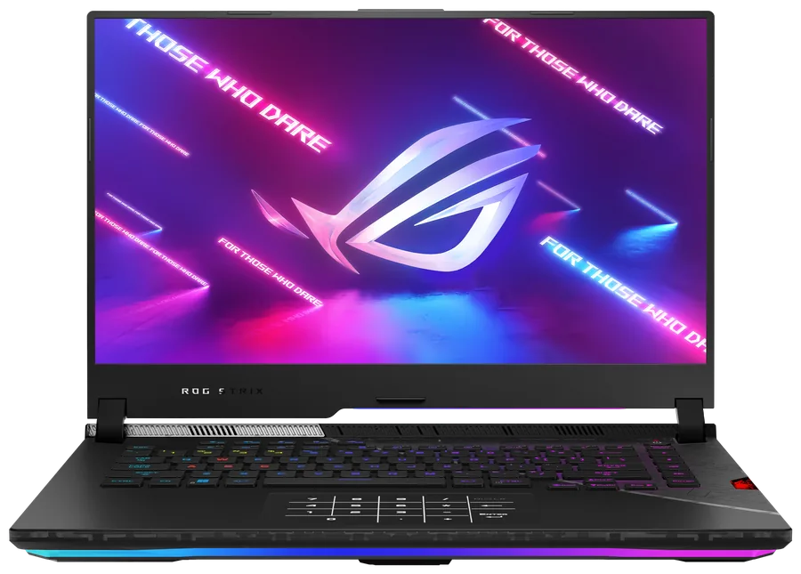
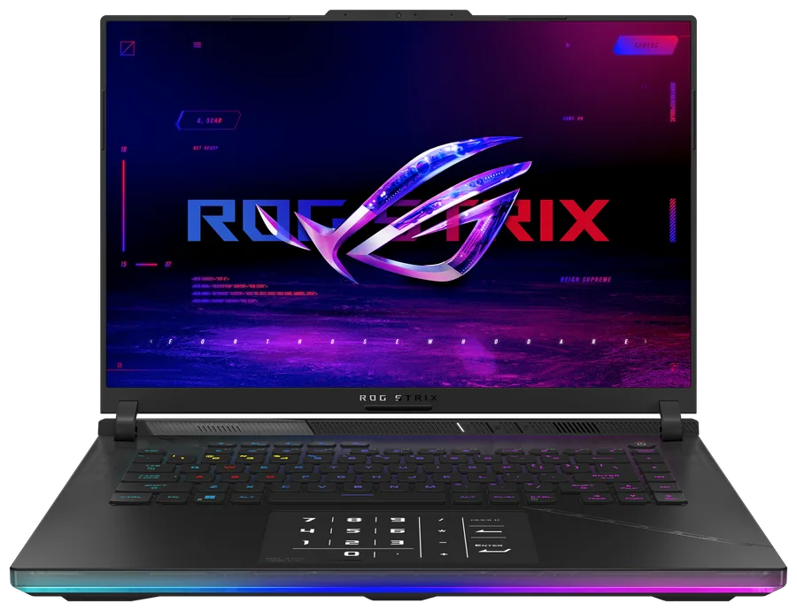
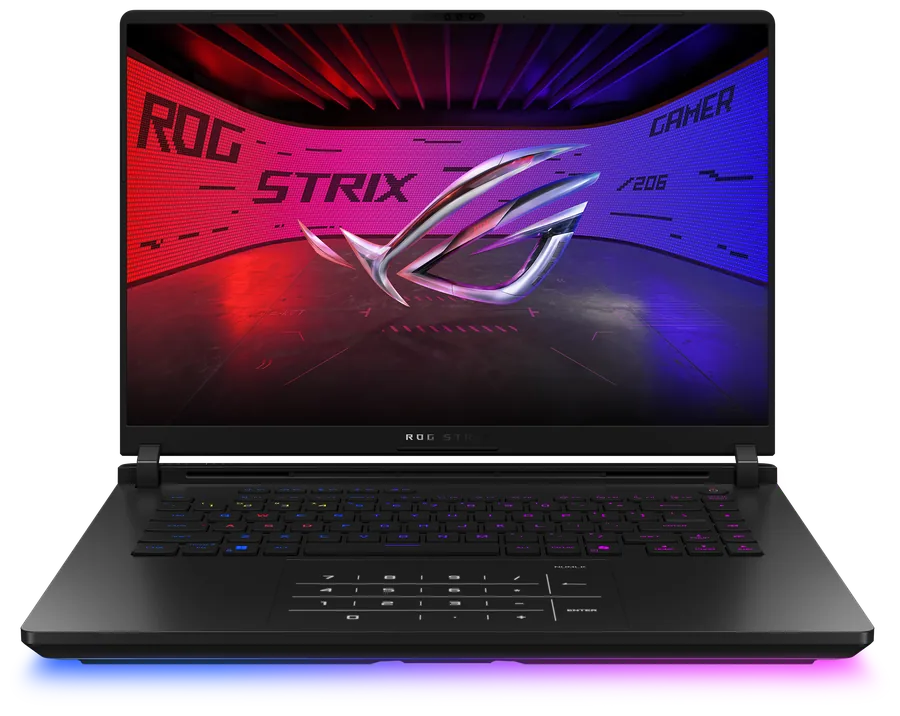
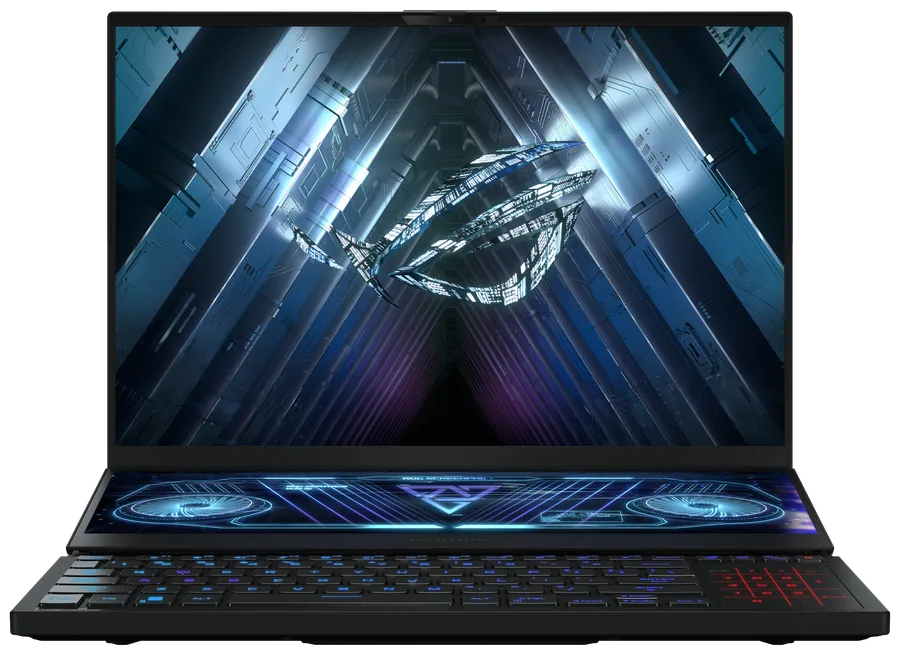
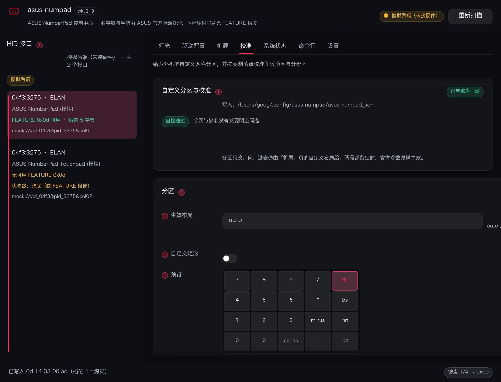
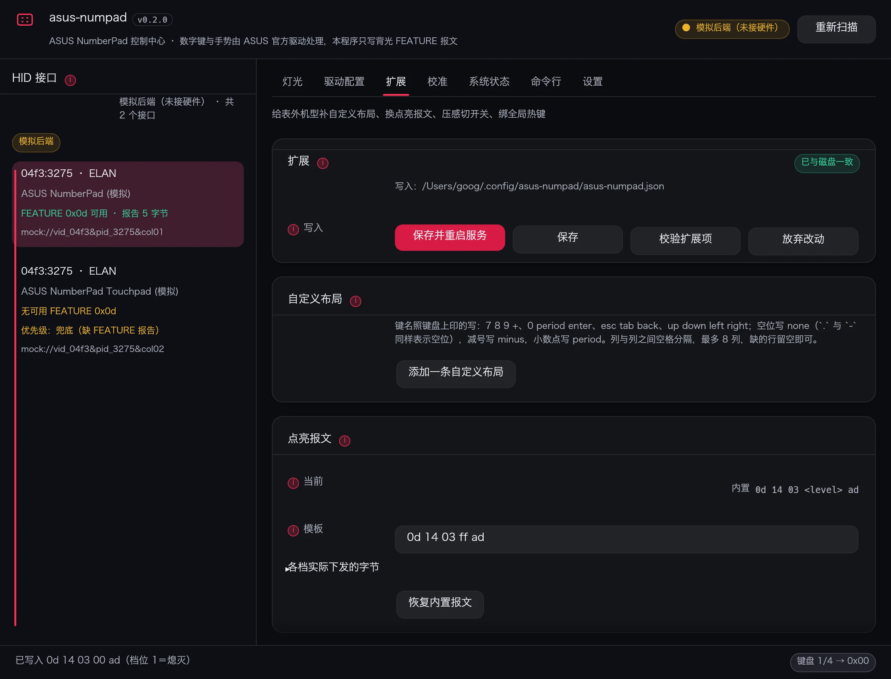
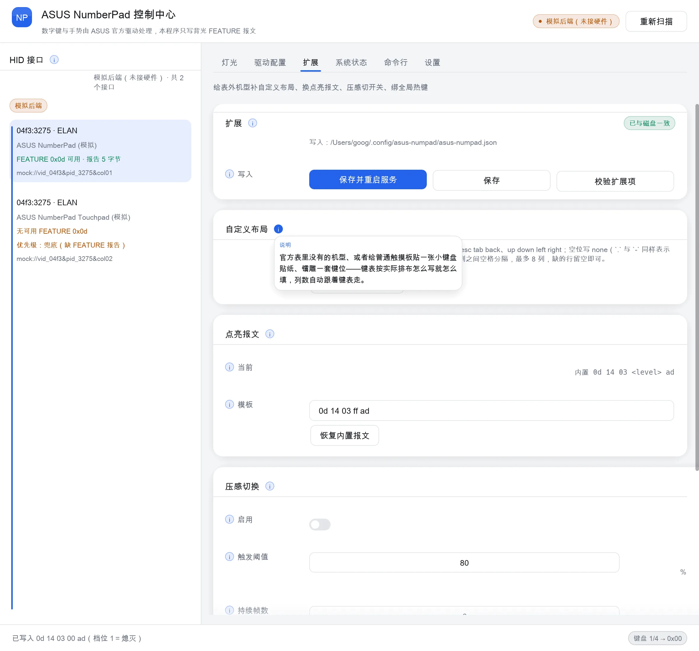
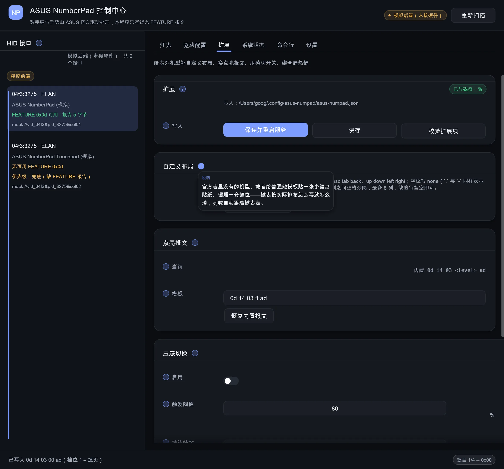
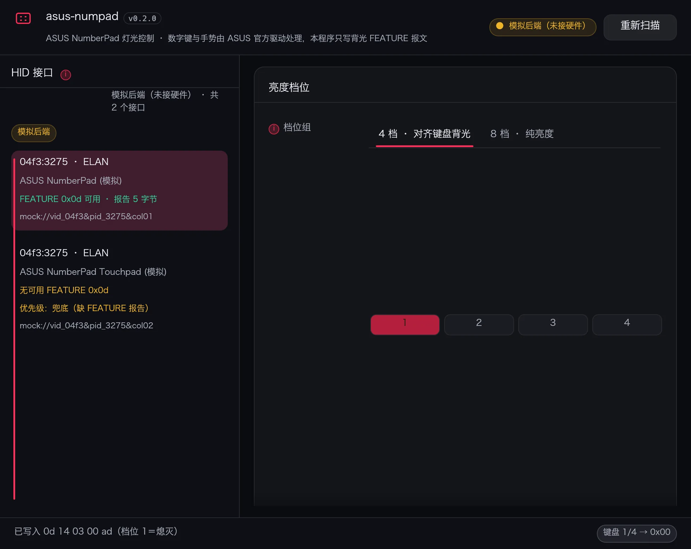
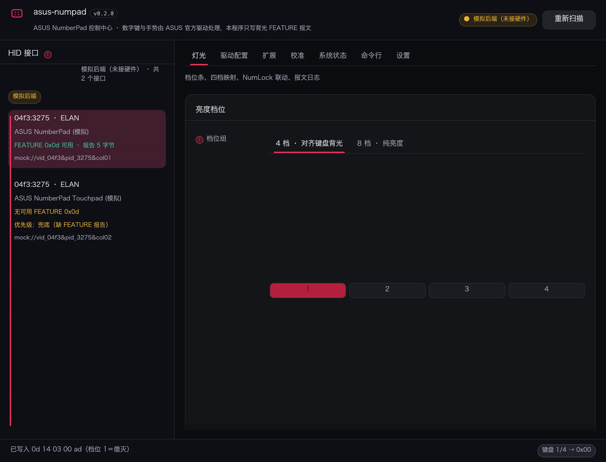

# numdeck

[English](README.md) | 简体中文 | [繁體中文](README.zh-TW.md) · [官网](https://numdeck-dev.github.io/)

ASUS NumberPad 的 Linux 用户态驱动。通过 evdev 独占触摸板，把触点换算成小键盘格，通过 uinput
注入按键。不替换内核模块，不打 ACPI 补丁，卸载即恢复原状。

时序与几何常量取自厂商文件 `AsusNUMPADFilter.inf` 中的 `AlgoParameters`。

## 安装

```bash
# Debian / Ubuntu
sudo install -d -m 0755 /usr/share/keyrings
curl -fsSL https://raw.githubusercontent.com/numdeck-dev/numdeck/main/repo/keys/numdeck-repo.gpg \
  | sudo tee /usr/share/keyrings/numdeck.gpg >/dev/null
echo "deb [signed-by=/usr/share/keyrings/numdeck.gpg] https://raw.githubusercontent.com/numdeck-dev/numdeck/main/repo/apt stable main" \
  | sudo tee /etc/apt/sources.list.d/numdeck.list
sudo apt update && sudo apt install numdeck

# Fedora / RHEL / Rocky / Alma
sudo rpm --import https://raw.githubusercontent.com/numdeck-dev/numdeck/main/repo/keys/numdeck-repo.asc
sudo tee /etc/yum.repos.d/numdeck.repo >/dev/null <<'EOF'
[numdeck]
name=numdeck
baseurl=https://raw.githubusercontent.com/numdeck-dev/numdeck/main/repo/rpm/$basearch
enabled=1
gpgcheck=1
repo_gpgcheck=1
gpgkey=https://raw.githubusercontent.com/numdeck-dev/numdeck/main/repo/keys/numdeck-repo.asc
EOF
sudo dnf install numdeck

# openSUSE Leap / Tumbleweed，同一个 rpm-md 源，zypper 直接读
sudo rpm --import https://raw.githubusercontent.com/numdeck-dev/numdeck/main/repo/keys/numdeck-repo.asc
sudo zypper addrepo --refresh \
  "https://raw.githubusercontent.com/numdeck-dev/numdeck/main/repo/rpm/$(uname -m)" numdeck
sudo zypper install numdeck

# Arch / Manjaro
curl -fsSL https://raw.githubusercontent.com/numdeck-dev/numdeck/main/repo/keys/numdeck-repo.asc -o /tmp/numdeck.asc
sudo pacman-key --add /tmp/numdeck.asc
sudo pacman-key --lsign-key 79F282157F2D3FF8E3C6806314C2BF611986E168
sudo tee -a /etc/pacman.conf >/dev/null <<'EOF'

[numdeck]
SigLevel = Required DatabaseRequired
Server = https://raw.githubusercontent.com/numdeck-dev/numdeck/main/repo/arch/$arch
EOF
sudo pacman -Syu numdeck

# Alpine
curl -fsSL https://raw.githubusercontent.com/numdeck-dev/numdeck/main/repo/keys/numdeck-apk.rsa.pub \
  | sudo tee /etc/apk/keys/numdeck-apk.rsa.pub >/dev/null
echo "https://raw.githubusercontent.com/numdeck-dev/numdeck/main/repo/alpine/$(apk --print-arch)" | sudo tee -a /etc/apk/repositories
sudo apk update && sudo apk add numdeck
```

每个生态一个包。deb 在 Ubuntu 22.04 上构建，覆盖 22.04 至 24.04 与 Debian 12、13。rpm 在
AlmaLinux 9 上构建，覆盖 RHEL、AlmaLinux、Rocky 9 至 10、Fedora、openSUSE Leap 16 与
Tumbleweed：spec 只用标准宏，运行时只依赖 glibc 与 systemd，仓库是 rpm-md，zypper 直接读，
不按发行版各编一份。原生包也在
[Releases](https://github.com/numdeck-dev/numdeck/releases)：deb、rpm、pkg.tar.zst、带
.SRCINFO 的 PKGBUILD、apk、静态 tarball。手工构建 PKGBUILD：把 `PKGBUILD` 与
`numdeck.install` 放进同一目录，执行 `makepkg -si`。Alpine、Gentoo、NixOS 与手动 tarball
步骤见 [docs/install.md](docs/install.md)。仓库与 release 附件同时提供 `x86_64`/`amd64` 与 `ARM64`/`aarch64` 两种架构，其余架构需本地自建。

`ci.yml` 每次推送都为每个生态构建包并检查包元数据；`release.yml` 另在每个目标发行版的干净容器里
安装每个包并执行 `numdeck --version`，安装失败的包会阻止发布。

包只有一个，机型在运行期识别：同一份二进制读 DMI 型号与触摸板模组，据此选参数与键表。表里对不上
的机器不启动：以退出码 3 结束并打印支持机型，不使用其他机型的参数。硬件信息读不准（虚拟机、白牌机箱、BIOS 占位串）时可手动指定，见
[机型识别](#机型识别)。运行依赖：glibc，Alpine 上为 musl。

ARM64 包是个例外：华硕原生 NumberPad 机型全是 x86_64，ARM 上没有可识别的机型，所以 ARM64
构建里直接**不含机型表**——不读 DMI、不认触摸板模组、也不按厂商过滤触摸板，启动时不拦机型，
只走自定义布局这条路（要自己在 `custom_layouts` 里绑触摸板、录键位，见[自定义布局](#自定义布局)）。
反过来，`x86_64` 包里没有为 ARM 预留任何兜底。

## 使用

```bash
numdeck check          # 只读自检：设备、布局换算、背光候选
numdeck dump           # 原始事件流
numdeck run            # 前台运行，由 systemd 单元启动
numdeck --dump-config  # 当前生效配置
```

```bash
numdeck bright 0..N         # 档位，0 为关（关闭跟随）；N 为档数，默认 4
numdeck bright up|down|cycle
numdeck bright follow on|off
numdeck bright status
```

```bash
numdeck levels              # 档位表：每一档写入的字节
numdeck levels 2 0x46       # 第 2 档写 0x46（取值 0x00 或 0x41..0x48）
numdeck levels reset        # 恢复默认四档
numdeck led on|off|0x41     # 绕过状态机，直发一个背光字节
numdeck layout              # 当前键表、全部已收录键表与支持级别
numdeck layout --ids        # 模组名到键表的映射
numdeck layout auto         # 恢复自动选择
```

```bash
numdeck lang [zh-CN|zh-TW|en|auto]
numdeck --lang en check     # 仅本次生效
```

语言优先级：`NUMDECK_LANG`、`--lang`、配置里的 `language`、系统 locale。

## 配置

`~/.config/numdeck/numdeck.json`，root 运行时为 `/etc/numdeck/`。未写入的键取厂商默认值。

| 键 | 取值 | 含义 |
| --- | --- | --- |
| `numlock` | `sync` / `toggle` / `off` | 跟随系统 NumLock 状态 |
| `calc_gesture` | `true` / `false` | 手势唤起计算器 |
| `calc_gesture_mode` | `long` / `off` | 触发方式 |
| `mixed_mode` | `auto` / `on` / `off` | `auto`：点亮期间只有双指及以上交给桌面，单指留在数字区；`on`：键区外一律交给桌面；`off`：纯数字键盘。`auto` / `on` 需要 `/dev/uinput` |
| `grab` | `true` / `false` | 独占触摸板；关闭后点击交给桌面 |
| `led_kind` | `auto` / `hidraw` / `i2c` / `none` | 背光通道 |
| `follow_keyboard_brightness` | `true` / `false` | 跟随键盘背光，默认 `true` |
| `manual_brightness_step` | `0`..`3` | 当前手动档（0 为关闭），跟随关闭时生效；上界为档数 |
| `manual_brightness_levels` | 数组 | 档位到取值的表，默认 `[0, 0x43, 0x45, 0x48]`；元素为 `0` 或 `0x41`..`0x48`；长度 1 到 8 即档位数；允许相邻相等；递减的表被丢弃 |
| `brightness_levels` | 数组 | 硬件档位，默认 `0x41`..`0x48` |
| `brightness_poll_ms` | 毫秒 | 轮询间隔，默认 `500` |
| `allow_unverified_layout` | `true` / `false` | 接受已知家族中未收录的布局 |
| `layout_name` | 键表名 / `auto` | 手动指定键表，`auto` 按模组选 |
| `sku` | 机型 id / `null` | 手动指定机型，跳过自动识别；`null` 为自动 |
| `custom_layouts` | 数组 | 自定义布局，见[扩展](#扩展给表外的机器补一套小键盘)：`name`、`base`、`hid_ids`、`keys`，以及可选的布局参数覆盖 |
| `led_proto` | 对象 | 自定义点亮报文：`template` 为字节数组，其中一个字节写 `255` 当档位占位符 |
| `pressure_switch` | 对象 | 压感触摸板「用力按＝切换」：`enabled`、`percent`、`frames`、`cooldown_ms` |
| `hotkeys` | 数组 | 物理键盘全局组合键：`gesture`（如 `ctrl+alt+n`）配 `action`（`toggle` / `on` / `off`） |

## 支持机型

| 机型 id | 机型与年份 | DMI 代号前缀 | 触摸板模组 | 键表 | 有配置不带该硬件 |
| --- | --- | --- | --- | --- | --- |
| `g533` | 枪神6 / 魔霸6，15 英寸，2022 | 前缀 `G533*`、`G513*`——2021 代的 `G533Q*` / `G513Q*` / `G513I*` 已排除 | `ASUE1403`、`ELAN1403` | `GH2XLNDZ` | 魔霸6 2022 五个配置里三个 |
| `g614` | 枪神7 及超竞版、枪神8 及超竞版，16 英寸，2023–2024 | `G614`、`G634` | `ASUE1416`、`ASUF1416` | `GH3XLNDZ` | 枪神7 2023 十个配置里两个（国行「魔霸新锐」即此类 4 区 RGB 版） |
| `g615` | 枪神9 及超竞版、枪神10 及超竞版，16 英寸，2025–2026 | `G615`、`G635` | `ASCP1400`、`ASCF1400` | `GH4XLNDZ` | 枪神9 2025 二十五个配置里一个（国行「魔霸新锐」即此类 4 区 RGB 版） |
| `gx550` | 冰刃双屏、冰刃 6 双屏、冰刃 7 双屏（Duo 15 / Duo 15 SE / Duo 16），侧置触摸板，15 / 16 英寸，2020–2023 | `GX550`、`GX551`、`GX650` | `ASUE1408`、`ASUE1404` | `GVM_A`、`GVM` | 官方列表里没有 |
| `ux582` | 灵耀 X 双屏、灵耀 X 双屏 Pro（UX482 / UX582），侧置触摸板，14 / 15 英寸，2020–2021 | `UX582`、`UX482` | `ASUE1406`、`ELAN1406` | `NVM` | 未逐配置核验 |

`GVM_A` / `GVM` / `NVM` 的参数取自官方 INF；官方只列到 `GVM_06` / `NVM_12`，不足一张完整表的 15 个
格位，空缺写 `0`——与 Windows 驱动读不到该项时的缺省一致，不做数值推测；`GVM_A` 与 `GVM` 共用同一份
参数（`NUMPADLAYOUT_GVM_05` / `_06` 的注释写明是「for GVMA」）。这两行状态是 `LayoutSupport::Family`：
5 列、网格与 GH3XLNDZ 同族，但未在真机上逐键核对过，启动需加 `--allow-unverified` 允许出键。

同一块触摸板跨年沿用同一代号，代号后的字符只跟 CPU 换代，触摸板本身不变：`G614` / `G634` 覆盖
2023 与 2024 两个年度（枪神7 → 枪神8 及超竞版），`G615` / `G635` 覆盖 2025 与 2026
（枪神9 → 枪神10 及超竞版，其中 `G615` 为标准版、`G635` 为超竞版）。2026 年没有换代号，机型表因此
不必新增一行。

这张表就是支持范围。机型 id 用来手动切换参数（`numdeck sku <id>`），并让自动识别的结果
看得见；表外的机器拒绝启动。每行的归属依据触摸板模组数据与键表映射判定，不按整机型号逐个验证；
各机型当前的兼容情况详见[官网](https://numdeck-dev.github.io/)。

型号 id 命中不等于这台有硬件。同一型号的部分零售配置配的是 4 区 RGB 触控板、没有
NumberPad，且 DMI 前缀与带 NumberPad 的配置完全相同（`G614JV…-0EAGX…` 有，
`G614JV…-0EACX…` 没有；各代数量见上表）。所以键表始终按触摸板模组名选，绝不按型号代码推；
逐配置核验结果见 [docs/machines.md](docs/machines.md#同一型号不是都有-numpad按配置核验)。

幻16 系列（中国区名称，对应 Zephyrus M16 / G16 / Flow X16，`GU603`–`GV601`）属于表外而非漏支持：
官方规格页每一代的「键盘与触控板」栏都只有 `Touchpad`，没有图标区可驱动。带这块硬件的是双屏
`GX650`（冰刃 6 / 7 双屏），已由 `gx550` 行提供参数。逐代核验见
[docs/machines.md](docs/machines.md#幻16-系列无-numberpad已核验)。

一行机型条目由该代的 DMI 型号前缀与 `excludes` 组成：`excludes` 收的是复用了同一代号前缀、
但没有这块触摸板的老代际。命中的代号落到模组判据，都对不上则同样拒绝启动；手动指定的 `sku`
优先级最高。代号在不同区域档位之间同样会复用：`G614P*` 在中国区作为 2025 款魔霸 10 / 魔霸 9
销售，上表的配置级统计没有覆盖这些档位，键表仍由触摸板模组决定。

DMI 中的机型代码为准，市场名仅供对照。旧版按机型拆分的包名（`numdeck-g614` 等）留在
`Obsoletes` 中，升级时由 `numdeck` 接管。

| | |
| --- | --- |
|  |  |
| 枪神6 / 魔霸6（2022） | 枪神7 及超竞版（2023） |
|  |  |
| 枪神9 及超竞版（2025） | 冰刃 6 双屏（侧置触摸板，GX650，2022） |

产品图取自华硕产品页，仅用于识别机型。

### 双屏机型：侧置触摸板

现状：`GVM` / `GVM_A` / `NVM` 用的是官方原值（官方没列的项按缺省 `0`），两行状态为 `family`：
网格同为 5 列，但键位排布还没在真机上核对过，启动需加 `--allow-unverified`。下面是驱动按这套
键表实现的取向。

冰刃双屏与灵耀 X 双屏的 C 面被副屏占去一半，触摸板竖排在键盘右侧，不在掌心正下方。这类机器的数字
模式由**键盘上的专用切换键**控制（`GX550` 键盘上那颗 ScreenPad 键即属此类），不是长按触摸板
右上角的图标区。因此「长按 62 帧切数字模式」这条路径对侧置触摸板不成立：

- 触点映射与背光照旧：格心坐标按该模组的键表平移，背光仍走 FEATURE `0x0d`；
- 模式开关交给键盘专用键——键盘走自己的 HID 节点，驱动只抓触摸板，不抢这个键；
- 需要固定数字模式时用配置项 `numlock`（`sync` / `toggle` / `off`），不靠长按手势。

### 机型识别

识别取 DMI 的 `product_name`、`board_name`、`product_family` 三者的并集。BIOS 占位字符串按缺失
处理，不阻塞启动；明确不是 ASUS 的厂商字段会阻塞启动。

触摸板模组名（如 `ASUE1416`，来自 i2c-hid 与 HID）是第二判据，在 DMI 说不出机型时启用。
两个判据都没对上具体机型，即判定为表外机器：以退出码 3 拒绝启动，`--sku` 是唯一的跳过校验
方式。各机型的模组与键表见 [docs/machines.md](docs/machines.md)。

读不到正确硬件信息时手动指定：

```bash
numdeck sku            # 看识别到哪套配置、凭什么
numdeck sku list       # 列出可选机型 id
numdeck sku g614       # 手动指定，写进配置长期生效
numdeck sku auto       # 恢复自动识别
```

配置里的 `sku` 键优先于自动识别，`--sku g614` 只对本次运行生效。

### 布局校验

键表按触摸板模组名选：`src/layout.rs` 的 `HID_LAYOUTS` 把 44 个模组名映射到厂商 INF 里的键表名，
每张键表带一个支持级别。

| 级别 | 行为 |
| --- | --- |
| `verified` | 直接启动 |
| `family` | 5x4 网格相同、官方参数已全部照录（官方没列的项按缺省 `0`），但未在真机逐键验证：默认拒绝，需显式允许 |
| `unsupported` | 参数已收录，但无键位排布依据且未经真机核对：默认拒绝，提示附 `check` 输出反馈 |

表里没有的模组落到 `UNKNOWN`，按同样方式拒绝。未知面板不会被映射到会误按键的键表上。校验只
覆盖键表，与机型 id 无关。

```bash
numdeck --allow-unverified run    # 或在配置中设 allow_unverified_layout: true
```

## 扩展：给表外的机器补一套小键盘

机型表之外的机器，只要触摸板报得出按键坐标，就能自己补一套，不必等驱动加机型。按手上这台机器的
条件选：

| 手上是哪一种 | 配什么 | 有没有背光 |
| --- | --- | --- |
| 触摸板上有镭雕数字，或贴了一张小键盘贴纸 | `custom_layouts` 写一套键表 | 没有，顶多被键盘背光顺带照亮 |
| 普通玻璃面触摸板，只想照着贴纸出数 | 同上，`keys` 按贴纸的排布写 | 同上 |
| 触摸板确实会亮，只是报文不是 `0d 14 03 .. ad` | `led_proto` 换报文 | 有 |
| 触摸板会报压力轴 | `pressure_switch` 用力按切换 | 不影响 |
| 想直接用物理键盘开关小键盘 | `hotkeys` 绑组合键 | 不影响 |

四样相互独立，缺哪样配哪样；都配在同一个 `numdeck.json` 里，界面「扩展」页也在改同一份文件。

### 自定义布局

```json
{
  "custom_layouts": [
    {
      "name": "GH3X-贴纸",
      "base": "GH3XLNDZ",
      "hid_ids": ["ASUE1416", "ASUE1419"],
      "keys": [
        "7 8 9 / bs",
        "4 5 6 * minus",
        "1 2 3 plus enter",
        "0 0 period . enter"
      ]
    }
  ]
}
```

- `name` 就是键表名：`layout_name` 写它能选中；留 `auto` 时按 `hid_ids` 命中的模组自动选。
- `base` 是参数基准，可以是内置键表名，也可以是同一份配置里排在它前面的另一条自定义布局（用来
  「照抄某套几何，只改两格」）。几何参数（`columns`、`left`、`right`、`top`、`bottom`、`gap` 等）
  不写就照抄基准；`columns` 由 `keys` 的列数自动改写，不用手填。
- `keys` 是 4 行键表，列数 1..=8、行数固定 4。四行列数必须一致，不一致这张布局直接判为不可用，
  界面上会写明原因。留空表示沿用基准的键表（只改几何、不改键位时这么写）。
- `hid_ids` 绑的是**触摸板模组的 HID 硬件 ID**（`ASUE1416` 这一层），不是整机型号：绑上之后这台
  机器不用再改 `layout_name` 也能命中。绑到内置表里已有的模组时会提示「已覆盖官方映射」。
- 自定义布局按 `verified` 处理——它是你自己写的，驱动不再用 `family` / `unsupported` 那套拦你。

键位怎么写（空格分隔，大小写不敏感）：

| 想按出来的键 | 写成 |
| --- | --- |
| 数字 | `7` |
| 键盘上印的符号 | `+`、`*`、`/`（也认 `plus`、`asterisk`、`slash`） |
| 小数点 | `period`（`.` 是空位，不能当小数点用） |
| 减号 | `minus`（`-` 是空位） |
| 回车、退格 | `enter`、`bs` |
| 空位（这一格不出键） | `none`，也可写 `.` 或 `-` |
| 其他键 | `kp7`、`F13`、`backspace`、`volup` 这类名字，或直接写键码 `0x64` / `100` |

界面「扩展」页的键表就是这几行文本，改完当场显示「几列 × 4 行，可用」或具体哪一行对不上。

### 自定义点亮报文

```json
{ "led_proto": { "template": [13, 20, 3, 255, 173] } }
```

- `template` 是整条 HID FEATURE 报文，第一个字节是 report ID。其中一个字节写 `255`（`0xff`）当
  **档位占位符**，点亮时被替换成当前档位值（`0x41`..`0x48`，熄灭是 `0`）。
- 必须恰好有一个 `255`，长度 2..=64 字节；否则整条报文作废、回落到内置报文，界面和 `--verbose`
  都会提示。
- 界面里按十六进制编辑（`0d 14 03 ff ad`），字节之间用空格分开。

### 压感切换

```json
{ "pressure_switch": { "enabled": true, "percent": 85, "frames": 6, "cooldown_ms": 600 } }
```

- 触摸板报压力轴时，压力连续 `frames` 帧超过满量程的 `percent`%，算一次「用力按」，翻转小键盘
  开关。一帧等于 `frame_ms`（默认 8 ms），所以默认 6 帧约 50 ms。
- `cooldown_ms` 是两次翻转之间的最小间隔，防止按住不放连续翻转。
- 与 `mixed_mode` 互不影响：这里只翻开关状态，不合成按键，也不把压力事件转发给桌面。
- 触摸板不报压力轴时这项不起作用，配置留着无害。

### 全局热键

```json
{ "hotkeys": [ { "gesture": "ctrl+alt+n", "action": "toggle" } ] }
```

- `gesture` 用 `+` 连接键名：`ctrl`、`alt`、`shift`、`super` 加一个普通键。
- `action` 三个值：`toggle` 翻转、`on` 只开、`off` 只关。
- 只旁听物理键盘事件、不 grab 键盘，正常打字不受影响；写错的组合键会在界面上提示并跳过。

### 自定义分区与手动校准

机型表里的 15 项几何参数都建立在 5x4 等分网格上。两种机型不够用：丝印排法不同（列宽不等、六七列），
或者内核上报的坐标根本铺不满面板。校准页管的就是这两种。

```json
{
  "partition": {
    "layout": "auto",
    "rect": [405, 520, 3630, 2280],
    "cols": 5,
    "rows": 4,
    "col_ratios": [1, 1, 1, 1, 1],
    "row_ratios": [1, 1, 1, 1],
    "snap_outside": false
  },
  "calibration": {
    "x": { "min": 0, "max": 3600, "units_per_mm": 40 },
    "y": { "min": 0, "max": 2200 }
  }
}
```

- `rect` 是 `[x0, y0, x1, y1]`，用触摸板原始坐标，和 `evtest` 里看到的一致。为空或上下界写反
  会被拒绝并点名，改回内置网格，不会带着坏几何跑。
- `cols` 取 1..=8，`rows` 取 1..=4；留空就跟随键表。
- `col_ratios` / `row_ratios` 让网格不等分（比如最右一列宽些），填的是权重，按矩形自动归一，
  长度得与列数 / 行数对上。这一项只在配置里，界面没摆。
- `snap_outside` 默认关。打开后网格外的落点吸附到最近一格，而不是算进光标区。
- `calibration` 覆盖内核对两个轴的上报：`min` / `max` / `units_per_mm`（每毫米 30 个单位，手势
  按毫米算出来的像素值才对）。只做线性映射，不交换轴也不翻转；某一轴不覆盖就沿用内核值。
- 分区只对 `partition.layout` 点名的布局生效（`auto` 跟当前生效布局），所以一份文件里可以给
  多个布局各留一套分区。
- 另有两个键没有对应控件：`rect_mm`（用面板左上角起的毫米写同一个矩形，原始单位与实测对不上时
  用它）与 `numlock_cell`（NumLock 图标所在格 `[行, 列]`，默认第 0 行最后一列）。

量比猜准：`numdeck calibrate --samples samples.json` 收四角按压加两个对角格中心，直接解出
矩形与格尺寸；加 `--write` 落盘，并把上一份存成 `.bak`。校准页的「样本回放」把同一份样本喂给
同一个解算函数，真机上采一次，界面里就能反复解。底部「配置片段」把 `partition` + `calibration`
打包，方便搬给同机型的人；片段不含键表，键表在 `custom_layouts` 里。



### 把配置搬给同机型的人

扩展页最底下是「配置片段」：点「导出」把四项扩展打包成一段 JSON，对方贴进同一个框、点「应用」
就装上了。片段只含 `custom_layouts` / `led_proto` / `pressure_switch` / `hotkeys`，不含帧节拍、
几何兜底、界面语言这些按机器走的项——换机型时它们本来就该重设。导入是全有或全无：四项里任何一项
解析失败都整段不落地，不会留下改了一半的配置；模板不合法的报文也会被点名拒绝。除了导出到框里，
还能「复制」进剪贴板直接发，「存成文件」写一份 `.json` 到下载目录（重复导出不覆盖上一份）。

### 配完先自检

```sh
tools/verify-extend.sh
```

22 项只读检查：二进制、扩展相关单测逐个点名跑、`custom_layouts` / `led_proto` /
`pressure_switch` / `hotkeys` 是否真的进了 `layout` 与 `check`、`--lang` 切语言、
坏值是否被拒并留提示。全程用 `mktemp` 临时配置，不碰 `~/.config`，也不写任何
hidraw 设备。需要手指按触摸板的三项（压感切换、热键、自定义报文）只打印命令，
不代替你执行。



每一行参数、每个区块标题和按钮都挂了悬浮说明，不用把 README 摊在旁边：




### 与机型表、布局校验的关系

两层闸门是分开的：机型（DMI / `sku`）决定「这台机器允不允许跑」，键表（`HID_LAYOUTS`）决定
「按哪里出什么键」。自定义布局只解决第二层——模组在表外、或者在表里但键位排布不对时用它；整机
认不出来仍然要 `--sku` 或 `sku` 配置过第一层。

## 常见问题

### 为什么只支持华硕机型？

驱动不依赖华硕私有接口：输入取自触摸板的 evdev 节点，按键经 uinput 输出，不涉及厂商内核模块与
ACPI 对象，任意多点触控板走的是同一条代码路径。移植工作集中在替换机型条目（DMI 的
`product_name` 加触摸板 HID 名）与布局常量（格心坐标、各阈值）。

无法移植的是硬件。NumberPad 面板提供两样其他 OEM 触摸板通常没有的能力：

- **可寻址背光。** 落指格位与数字模式状态由 LED 图案指示，经 HID FEATURE 报文 `0x0d`
  （`[0d 14 03 <v> ad]`，`0x41`..`0x48` 为亮度档）驱动。没有这层背光，按键仍能输出，但无法指示
  手指所在格位，也无法指示数字模式是否开启。
- **出厂标定表。** `AsusNUMPADFilter.inf` 中的 `AlgoParameters` 固定了帧长（8 ms）、几何单位
  （0.1 mm）、轻点窗口（350 ms）、NumLock 长按（62 帧）、滑动阈值（4838 µm）与双指间距
  （40 mm）。没有这张表，这些值只能在从未按小键盘调校过的面板上拟合，轻点与滑动识别无法与
  Windows 驱动对齐。

因此支持范围限定在同时具备两者的面板。`src/sku.rs` 的机型表即支持范围，负责启动校验；键表与
支持级别在 `src/layout.rs` 的 `HID_LAYOUTS`，按触摸板模组另选一套，表里没有的模组停在
[布局校验](#布局校验)。具备这两项能力的面板，接入工作是一行表项加布局常量，欢迎提交补丁。

### 为什么做成用户态驱动而不是内核模块？

- 面板经 ELAN i2c-hid（`04F3:3275` / `ASUE1416`）接入，不在华硕 `0B05` 键盘控制器之下，现有
  内核模块覆盖不到它，接入也不需要替换任何模块。
- 背光控制是触摸板自身 hidraw 节点上的 HID FEATURE 报文，用户态进程即可下发，不必进入内核。
- 时序、几何与阈值逐项取自厂商 INF，状态机行为与 Windows 驱动一致，机型差异集中在一张参数表里。
- 启动路径没有改动。卸载即移除 service unit 与 udev 规则，恢复原状，内核升级不会带来回归。

### 会考虑 PR 进 asusctl 吗？

暂无计划。这块触摸板只在少数机型上出现，驱动运行之后没有需要持续调节的项，合并进去意味着
要跟随 asusctl 的架构与发布节奏，而它的其余用户用不到这个功能。向本项目提交补丁，或在 asusctl
侧实现同样的功能，两条路都欢迎。

## 工作原理

### 数据链路

```
触摸板 --evdev(/dev/input/eventN)--> 帧缓冲(8 ms) --> 状态机 --uinput(/dev/uinput)--> 按键事件
                                                         |
                                                         `--> hidraw FEATURE 报文 --> 小键盘背光
```

### 时序与几何

| 参数 | 取值 | 含义 |
| --- | --- | --- |
| 帧长 | 8 ms | 状态机时基，长按 62 帧（496 ms） |
| 长度单位 | µm / 0.1 mm | 手势与滑动阈值以微米计，布局偏移以 0.1 mm 计 |
| 点击间隔 | 350 ms | `NUMPADGESTURE_03/04`：第二次点按算作独立按键的最小间隔 |
| NumLock 长按 | 62 帧 | `NUMPAD_GH2XLNDZ_01` / `_GH3XLNDZ_01`，图标区切换数字模式（居中式触摸板；侧置触摸板见[双屏机型](#双屏机型侧置触摸板)） |
| NumLock 漂移 | 2741 µm | `NUMPAD_09`：仍按长按处理的位移上限 |
| 滑动阈值 | 4838 µm | `NUMPADGESTURE_05`：超过即取消本次按键、转为手势 |
| 双指间距 | 40 mm | `NUMPADGESTURE_08`：滚动允许的最大指距，超过则按张开双指交给桌面 |
| 应用手势 | 7000 µm | `NUMPAD_07`：多指手势的触发距离 |

### 键表

键表按触摸板模组和 HID 名称选择，不按笔记本型号。`HID_LAYOUTS` 收录 44 条 HID 名称到键表的映射，
覆盖厂商 `SupportList` 中的每个模组；`ASUE1416`、`ASCF1400` 这类模组前缀可在
`/sys/class/input/*/name` 中看到。每条映射带支持级别，见[布局校验](#布局校验)。

小键盘位于触摸板右上角，5 行 4 列（侧置触摸板取的是触摸板自身的右上角，只是整块触摸板排在键盘右侧）。
格子中心即 `NUMPADLAYOUT_GH3XLNDZ_00..14` 的坐标，单位
0.1 mm。坐标到格子、格子到键码的换算不含硬件依赖，有单元测试。

### 背光

```
报文: 0d 14 03 <档位> ad   # 6 字节，HID FEATURE 报文 ID 0x0d
档位: 0x41..0x48           # 第 1..8 档
      0x00                 # 关闭
      0x01                 # 开启，沿用当前档位
写入: HIDIOCSFEATURE       # 无需 0x60 解锁
```

`bright follow on` 读取 `/sys/class/leds/asus::kbd_backlight/brightness` 的 `current` 与 `max`，
把比值映射到 1..8 档，每 500 ms 轮询，仅在档位变化时写入。手动档位与跟随模式共用一张档位表。

节点选择（`led_policy.rs`）：始终排除 OMNI 接收器 `0b05:1ace`；ELAN `04f3:*` 且带 FEATURE
`0x0d` 优先，其次 ASUS `0b05:*`，最后 i2c（`0x38` / `0x15`）。

### 图形界面

同一份 crate 出两个窗口：Windows 上只管灯光，Linux 上是完整的控制中心。



`gui/` 发的报文与 CLI 完全相同，两端都出自共用的 `led_proto` 层，字节不会漂移。

Windows 的窗口只解决灯光：接口列表、亮度档位、跟随 NumLock、写入日志。小键盘输入交给官方驱动，
后端是 `setupapi` + `hid.dll`，不碰 hidraw。

Linux 上是全套，分七个页签：

| 页签 | 内容 |
| --- | --- |
| 灯光 | 接口列表、键盘四档 → 触摸板亮度映射（逐档可改、可试亮、可与驱动配置互相同步）、点亮 / 熄灭、跟随 NumLock 与键盘背光、报文日志 |
| 驱动配置 | 驱动配置（`~/.config/numdeck/numdeck.json`，root 下 `/etc/numdeck/numdeck.json`）的每个字段都做成控件：机型、布局、键码风格、NumLock 策略、手势阈值、背光通道与跟灯轮询、手动档位表、时序常数、驱动语言 |
| 系统状态 | 配置文件路径、机型、布局、hidraw 通道、单元状态，可启动 / 停止 / 重启 |
| 扩展 | 给表外机型补自定义布局、换点亮报文、压感切换开关、绑全局热键，以及可转发的配置片段 |
| 校准 | 给表外机型自定义网格分区（矩形、列数、比例）与轴校准，附样本回放与配置片段 |
| 命令行 | 每个 `numdeck` 子命令一张表单，执行时跑同一个可执行文件 |
| 设置 | 档位数、跟随 NumLock、轮询间隔、开机自启 |



改动在按保存之前只停在内存里；「保存并重启」会写盘并重启 `numdeck` 用户单元，一步到位。
界面上不重写一遍 CLI 的逻辑：命令页执行的就是真二进制，输出原样贴回。

```bash
cargo run -p numdeck-gui      # 或 cargo build --release -p numdeck-gui
```

运行条件、设置文件位置与排错见 `gui/README.md`。

### 权限

不需要 root。udev 给 hidraw 与 event 节点打 `TAG+="uaccess"`，守护进程以 `systemd --user` 单元
运行，`/dev/uinput` 由会话授权。

## 源码结构

| 路径 | 用途 |
| --- | --- |
| `src/lib.rs` | 库入口：可执行文件与 GUI 共用的模块 |
| `src/main.rs` | CLI 解析与装配 |
| `src/engine.rs` | 厂商算法状态机 |
| `src/layout.rs` | 布局几何、44 条 HID 表、坐标换算 |
| `src/config.rs` | 默认值、读写、旧路径迁移 |
| `src/brightness.rs` | 键盘背光到小键盘档位的映射 |
| `src/led_policy.rs` | 背光节点打分 |
| `src/sku.rs` | 机型表、运行期识别、手动指定、代际排除 |
| `src/i18n.rs` | 三种语言，可用外部 `.lang` 文件覆盖 |
| `src/keycodes.rs` | Linux input 事件码，自带一份让 `layout` / `engine` 跨平台可编译 |
| `src/led_proto.rs` | 背光 FEATURE `0x0d` 报文的编解码，CLI 与 GUI 的单一真源 |
| `src/linux/` | evdev、uinput、hidraw、i2c 后端 |
| `gui/` | egui 窗口：Windows 只管灯光，Linux 是完整控制中心 |
| `lang/` | zh-CN、zh-TW、en 文案 |
| `site/` | 官网源码，发布到 https://numdeck-dev.github.io/ |
| `tools/` | `push-site.sh`（官网同步）、`repo-gen.sh`（仓库索引） |
| `packaging/` | deb、rpm、Arch、Alpine、Gentoo、Nix、tarball 脚本与仓库工具 |

## 构建

### 交叉构建另外两个平台

```bash
./tools/build-cross.sh            # 两个都建
./tools/build-cross.sh windows    # x86_64-pc-windows-gnu + aarch64-pc-windows-gnullvm
./tools/build-cross.sh linux      # x86_64-unknown-linux-gnu + aarch64-unknown-linux-gnu
```

脚本会自己下 zig（它自带 `windows-gnu` / `linux-gnu` 要用的 MinGW 与 glibc，不用装
mingw-w64、也不用起容器），缺 `cargo-zigbuild` 就装。Linux 目标固定 glibc 2.17 下限，
Ubuntu 18.04 之后都能直接跑。GUI 那个 crate 不做交叉构建——它要吃目标平台的合成器。

```bash
./packaging/build.sh                        # 当前发行版
./packaging/build.sh deb rpm tarball        # 指定目标（deb/rpm/arch/alpine/tarball）
./tools/repo-gen.sh                         # dist/ 生成本地仓库到 repo/（apt/rpm/pacman/apk）
```

```bash
RUSTFLAGS="-C linker=rust-lld -C link-self-contained=yes" \
  cargo build --target x86_64-unknown-linux-musl --release
```

打包细节见 [packaging/README.md](packaging/README.md)。打 `v*` 标签会触发
`.github/workflows/release.yml`，在按发行版划分的容器里构建、生成四套仓库索引、发布 release 并把
`repo/` 提交回 `main`。

官网源码就在本仓的 `site/`：`./tools/push-site.sh` 把它同步到 `numdeck-dev/numdeck-dev.github.io`
仓库，由该仓库提供 https://numdeck-dev.github.io/ 。`docs/` 只放项目文档，`docs/index.html` 是让
旧的项目站点地址继续可用的跳转页。

## 许可

GPL-3.0-or-later，见 [LICENSE](LICENSE)。

Copyright (C) 2026 the numdeck authors
