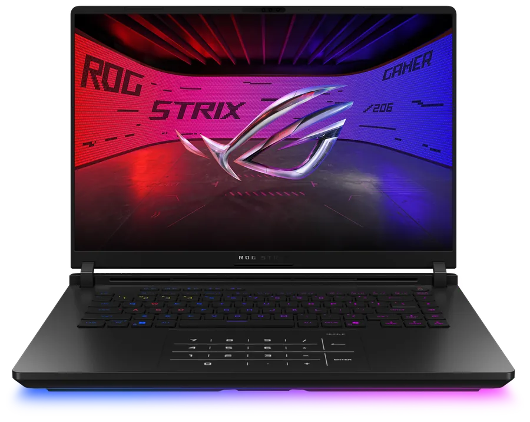
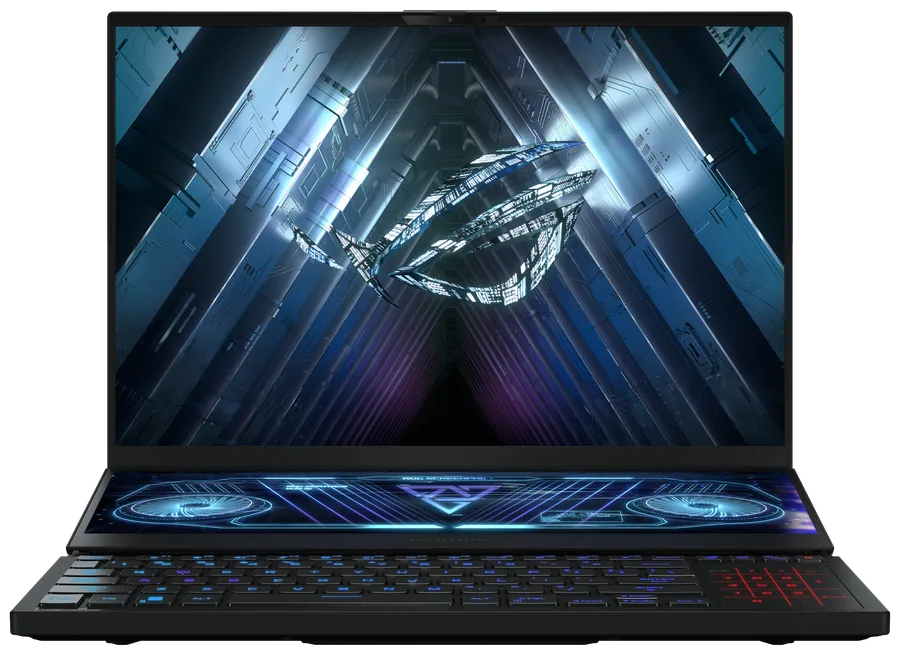

# asus-numpad

[English](README.md) | [简体中文](README.zh-CN.md) | 繁體中文 · [官網](https://asus-numpad.github.io/)

ASUS NumberPad 的 Linux 使用者空間驅動程式。透過 evdev 獨佔觸控板，把觸點換算成小鍵盤格位，
再經 uinput 注入按鍵。不替換核心模組，不修改 ACPI 表，解除安裝即回復原狀。

時序與幾何常數取自廠商檔案 `AsusNUMPADFilter.inf` 中的 `AlgoParameters`。

## 安裝

```bash
# Debian / Ubuntu
sudo install -d -m 0755 /usr/share/keyrings
curl -fsSL https://raw.githubusercontent.com/asus-numpad/asus-numpad/main/repo/keys/asus-numpad-repo.gpg \
  | sudo tee /usr/share/keyrings/asus-numpad.gpg >/dev/null
echo "deb [signed-by=/usr/share/keyrings/asus-numpad.gpg] https://raw.githubusercontent.com/asus-numpad/asus-numpad/main/repo/apt stable main" \
  | sudo tee /etc/apt/sources.list.d/asus-numpad.list
sudo apt update && sudo apt install asus-numpad

# Fedora / RHEL / Rocky / Alma
sudo rpm --import https://raw.githubusercontent.com/asus-numpad/asus-numpad/main/repo/keys/asus-numpad-repo.asc
sudo tee /etc/yum.repos.d/asus-numpad.repo >/dev/null <<'EOF'
[asus-numpad]
name=asus-numpad
baseurl=https://raw.githubusercontent.com/asus-numpad/asus-numpad/main/repo/rpm/$basearch
enabled=1
gpgcheck=1
repo_gpgcheck=1
gpgkey=https://raw.githubusercontent.com/asus-numpad/asus-numpad/main/repo/keys/asus-numpad-repo.asc
EOF
sudo dnf install asus-numpad

# openSUSE Leap / Tumbleweed，同一個 rpm-md 來源，zypper 直接讀
sudo rpm --import https://raw.githubusercontent.com/asus-numpad/asus-numpad/main/repo/keys/asus-numpad-repo.asc
sudo zypper addrepo --refresh \
  "https://raw.githubusercontent.com/asus-numpad/asus-numpad/main/repo/rpm/$(uname -m)" asus-numpad
sudo zypper install asus-numpad

# Arch / Manjaro
curl -fsSL https://raw.githubusercontent.com/asus-numpad/asus-numpad/main/repo/keys/asus-numpad-repo.asc -o /tmp/asus-numpad.asc
sudo pacman-key --add /tmp/asus-numpad.asc
sudo pacman-key --lsign-key 79F282157F2D3FF8E3C6806314C2BF611986E168
sudo tee -a /etc/pacman.conf >/dev/null <<'EOF'

[asus-numpad]
SigLevel = Required DatabaseRequired
Server = https://raw.githubusercontent.com/asus-numpad/asus-numpad/main/repo/arch/$arch
EOF
sudo pacman -Syu asus-numpad

# Alpine
curl -fsSL https://raw.githubusercontent.com/asus-numpad/asus-numpad/main/repo/keys/asus-numpad-apk.rsa.pub \
  | sudo tee /etc/apk/keys/asus-numpad-apk.rsa.pub >/dev/null
echo "https://raw.githubusercontent.com/asus-numpad/asus-numpad/main/repo/alpine/$(apk --print-arch)" | sudo tee -a /etc/apk/repositories
sudo apk update && sudo apk add asus-numpad
```

每個生態各一個套件。deb 在 Ubuntu 22.04 上建置，涵蓋 22.04 至 24.04 與 Debian 12、13。rpm 在
AlmaLinux 9 上建置，涵蓋 RHEL、AlmaLinux、Rocky 9 至 10、Fedora、openSUSE Leap 16 與
Tumbleweed：spec 只用標準巨集，執行期僅相依 glibc 與 systemd，倉庫格式為 rpm-md，zypper 直接
讀取，不按發行版各編一份。原生套件也在
[Releases](https://github.com/asus-numpad/asus-numpad/releases)：deb、rpm、pkg.tar.zst、附
.SRCINFO 的 PKGBUILD、apk、靜態 tarball。手動建置 PKGBUILD：把 `PKGBUILD` 與
`asus-numpad-rs.install` 放進同一目錄，執行 `makepkg -si`。Alpine、Gentoo、NixOS 與手動 tarball
步驟見 [docs/install.md](docs/install.md)。倉庫與 release 附件只提供 x86_64，其餘架構需自行建置。

`ci.yml` 每次推送都為每個生態建置套件並檢查套件中介資料；`release.yml` 另在每個目標發行版的
乾淨容器中安裝每個套件並執行 `asus-numpad --version`，裝不起來的套件會擋下發佈。

套件只有一個，機型在執行期辨識：同一份二進位檔讀取 DMI 型號與觸控板模組，據此選擇參數與鍵表。
表中對不上的機器不啟動：閘門以結束碼 3 中止並列出支援機型，不拿別的機型的參數去套未知硬體。硬體資訊讀不準（虛擬機、白牌機殼、BIOS 佔位字串）時可
手動指定，見[機型辨識](#機型辨識)。執行期相依：glibc，Alpine 上為 musl。

## 使用

```bash
asus-numpad check          # 唯讀自我檢查：裝置、佈局換算、背光候選
asus-numpad dump           # 原始事件流
asus-numpad run            # 前景執行，由 systemd 單元啟動
asus-numpad --dump-config  # 目前生效設定
```

```bash
asus-numpad bright 0..N         # 檔位，0 為關（關閉跟隨）；N 為檔數，預設 4
asus-numpad bright up|down|cycle
asus-numpad bright follow on|off
asus-numpad bright status
```

```bash
asus-numpad levels              # 檔位表：每一檔寫入的位元組
asus-numpad levels 2 0x46       # 第 2 檔寫 0x46（取值 0x00 或 0x41..0x48）
asus-numpad levels reset        # 回復預設四檔
asus-numpad led on|off|0x41     # 繞過狀態機，直接送出一個背光位元組
asus-numpad layout              # 目前鍵表、全部已收錄鍵表與支援等級
asus-numpad layout --ids        # 模組名對應鍵表的清單
asus-numpad layout auto         # 回復自動選擇
```

```bash
asus-numpad lang [zh-CN|zh-TW|en|auto]
asus-numpad --lang en check     # 僅本次生效
```

語言優先順序：`ASUS_NUMPAD_LANG`、`--lang`、設定檔中的 `language`、系統 locale。

## 設定

`~/.config/asus-numpad/asus-numpad.json`，以 root 執行時為 `/etc/asus-numpad/`。未寫入的鍵取廠商
預設值。

| 鍵 | 取值 | 含義 |
| --- | --- | --- |
| `numlock` | `sync` / `toggle` / `off` | 跟隨系統 NumLock 狀態 |
| `calc_gesture` | `true` / `false` | 手勢喚起計算機 |
| `calc_gesture_mode` | `long` / `off` | 觸發方式 |
| `mixed_mode` | `auto` / `on` / `off` | `auto`：點亮期間只有雙指以上交給桌面，單指留在數字區；`on`：鍵區外一律交給桌面；`off`：純數字鍵盤。`auto` / `on` 需要 `/dev/uinput` |
| `grab` | `true` / `false` | 獨佔觸控板；關閉後點擊交給桌面 |
| `led_kind` | `auto` / `hidraw` / `i2c` / `none` | 背光通道 |
| `follow_keyboard_brightness` | `true` / `false` | 跟隨鍵盤背光，預設 `true` |
| `manual_brightness_step` | `0`..`3` | 目前手動檔（0 為關閉），跟隨關閉時生效；上界為檔數 |
| `manual_brightness_levels` | 陣列 | 檔位對應取值的表，預設 `[0, 0x43, 0x45, 0x48]`；元素為 `0` 或 `0x41`..`0x48`；長度 1 到 8 即檔數；允許相鄰相等；遞減的表會被丟棄 |
| `brightness_levels` | 陣列 | 硬體檔位，預設 `0x41`..`0x48` |
| `brightness_poll_ms` | 毫秒 | 輪詢間隔，預設 `500` |
| `allow_unverified_layout` | `true` / `false` | 接受已知家族中未收錄的佈局 |
| `layout_name` | 鍵表名 / `auto` | 手動指定鍵表，`auto` 依模組選擇 |
| `sku` | 機型 id / `null` | 手動指定機型，跳過自動辨識；`null` 為自動 |

## 支援機型

| 機型 id | 機型與年份 | DMI 代號前綴 | 觸控板模組 | 鍵表 | 有配置不帶該硬體 |
| --- | --- | --- | --- | --- | --- |
| `g533` | Strix SCAR 15 / Strix G15，15 吋，2022 | 前綴 `G533*`、`G513*`——2021 代的 `G533Q*` / `G513Q*` / `G513I*` 已排除 | `ASUE1403`、`ELAN1403` | `GH2XLNDZ` | Strix G15 2022 五個配置裡三個 |
| `g614` | Strix SCAR 16 / Strix G16，16 吋，2023–2024 | `G614`、`G634` | `ASUE1416`、`ASUF1416` | `GH3XLNDZ` | Strix G16 2023 十個配置裡兩個 |
| `g615` | Strix SCAR 16 / Strix G16，16 吋，2025–2026 | `G615`、`G635` | `ASCP1400`、`ASCF1400` | `GH4XLNDZ` | Strix G16 2025 二十五個配置裡一個 |
| `gx550` | Zephyrus Duo 15 / Duo 15 SE / Duo 16（西風之神），側置觸控板，15–16 吋，2020–2023 | `GX550`、`GX551`、`GX650` | `ASUE1408`、`ASUE1404` | `GVM_A`、`GVM` | 官方列表中沒有 |
| `ux582` | Zenbook Duo 14 / Zenbook Pro Duo 15 OLED，側置觸控板，14–15 吋，2020–2021 | `UX582`、`UX482` | `ASUE1406`、`ELAN1406` | `NVM` | 未逐配置核驗 |

`GVM_A` / `GVM` / `NVM` 的參數抄自官方 inf；官方只列到 `GVM_06` / `NVM_12`，不足一張完整表的 15 個
格位，空缺寫 `0`——與 Windows 驅動讀不到該項時的預設一致，不做數值推測；`GVM_A` 與 `GVM` 共用同一份
參數（`NUMPADLAYOUT_GVM_05` / `_06` 的註解寫明是「for GVMA」）。這兩列狀態是 `LayoutSupport::Family`：
5 欄、網格與 GH3XLNDZ 同族，但沒在實機上逐鍵核對過，啟動需加 `--allow-unverified` 放行。

同一塊觸控板跨年度沿用同一代號，代號後的字母只跟 CPU 換代，觸控板本身不變：`G614` / `G634`
涵蓋 2023 與 2024 兩個年度（SCAR 16 → SCAR 16 2024），`G615` / `G635` 涵蓋 2025 與 2026
（Strix G16 2025 → 2026、SCAR 16 2025 → 2026，其中 `G615` 為標準版、`G635` 為 SCAR 版）。
2026 年沒有更換代號，機型表因此不必新增一列。

這張表就是支援範圍。機型 id 用來手動切換參數（`asus-numpad sku <id>`），並讓自動辨識的結果
看得見；表外的機器拒絕啟動。每一列的歸屬依觸控板模組資料與鍵表對應判定，不按整機型號逐台驗證；
各機型目前的相容情況詳見[官網](https://asus-numpad.github.io/)。

機型 id 命中不等於這台有硬體。同一機型的部分零售配置搭的是 4 區 RGB 觸控板、沒有
NumberPad，且 DMI 前綴與帶 NumberPad 的配置完全相同（`G614JV…-0EAGX…` 有，
`G614JV…-0EACX…` 沒有；各代數量見上表）。因此鍵表一律依觸控板模組名選擇，絕不從機型代號推；
逐配置核驗結果見 [docs/machines.md](docs/machines.md#同一型号不是都有-numpad按配置核验)。

幻16 系列（中國區名稱，對應 Zephyrus M16 / G16 / Flow X16，`GU603`–`GV601`）屬於表外而非漏支援：
官方規格頁每一代的「鍵盤與觸控板」欄都只有 `Touchpad`，沒有圖示區可驅動。帶這塊硬體的是雙螢幕
`GX650`（冰刃 6 / 7 雙屏），已由 `gx550` 列提供參數。逐代核驗見
[docs/machines.md](docs/machines.md#幻16-系列无-numberpad已核验)。

一列機型條目由該世代的 DMI 型號前綴與 `excludes` 組成：`excludes` 收的是沿用同一代號前綴、
但沒有這塊觸控板的舊世代。被排除的前綴會落到模組判據，兩者都對不上時同樣拒絕啟動；手動指定的
`sku` 優先於兩者。代號在不同區域產品線之間同樣會重用：`G614P*` 在中國市場以 2025 年款魔霸 10 /
魔霸 9 銷售，上表的逐配置統計沒有涵蓋這些產品線，鍵表仍由觸控板模組決定。

以 DMI 中的機型代碼為準，市場名稱僅供對照。舊版按機型拆分的套件名稱（`asus-numpad-g614`
等）留在 `Obsoletes` 中，升級時由 `asus-numpad` 接手。

| | |
| --- | --- |
|  |  |
| Strix SCAR 15 / Strix G15（2022） | Strix SCAR 16 / Strix G16（2023） |
|  |  |
| Strix SCAR 16 / Strix G16（2025） | Zephyrus Duo 16（側置觸控板，GX650，2022） |

產品圖取自華碩產品頁，僅用於辨識機型。

### 雙螢幕機型：側置觸控板

現狀：`GVM` / `GVM_A` / `NVM` 用的是官方原值（官方沒列的項按預設 `0`），兩列狀態為 `family`：
網格同為 5 欄，但鍵位排布還沒在實機上核對過，啟動需加 `--allow-unverified`。以下是驅動按這套
鍵表實作的取向。

Zephyrus Duo 與 Zenbook Duo 的 C 面被副螢幕佔去一半，觸控板豎排在鍵盤右側，不在掌心正下方。
這類機器的數字模式由**鍵盤上的專用切換鍵**控制（`GX550` 鍵盤上那顆 ScreenPad 鍵即屬此類），
不是長按觸控板右上角的圖示區。因此「長按 62 幀切換數字模式」這條路徑對側置觸控板不成立：

- 觸點對應與背光照舊：格心座標依該模組的鍵表平移，背光仍走 FEATURE `0x0d`；
- 模式切換交給鍵盤專用鍵——鍵盤走自己的 HID 節點，驅動只抓觸控板，不搶這個鍵；
- 需要固定數字模式時使用設定項 `numlock`（`sync` / `toggle` / `off`），不靠長按手勢。

### 機型辨識

辨識取 DMI 的 `product_name`、`board_name`、`product_family` 三者的聯集。BIOS 佔位字串視為
缺失，不阻擋啟動；明確不是 ASUS 的廠商欄位會阻擋啟動。

觸控板模組名（如 `ASUE1416`，來自 i2c-hid 與 HID）是第二判據，在 DMI 說不出機型時啟用。兩個
判據都沒對上具體機型，即判定為表外機器：閘門以結束碼 3 拒絕啟動，`--sku` 是唯一的放行通道。
各機型的模組與鍵表見 [docs/machines.md](docs/machines.md)。

讀不到正確硬體資訊時手動指定：

```bash
asus-numpad sku            # 看辨識到哪一套設定、憑什麼
asus-numpad sku list       # 列出可選機型 id
asus-numpad sku g614       # 手動指定，寫進設定長期生效
asus-numpad sku auto       # 回復自動辨識
```

設定中的 `sku` 鍵優先於自動辨識，`--sku g614` 只對本次執行生效。

### 佈局閘門

鍵表依觸控板模組名選擇：`src/layout.rs` 的 `HID_LAYOUTS` 把 44 個模組名對應到廠商 INF 中的
鍵表名，每張鍵表帶一個支援等級。

| 等級 | 行為 |
| --- | --- |
| `verified` | 直接啟動 |
| `family` | 5x4 網格相同、官方參數已全部照錄（官方沒列的項按預設 `0`），但未在實機逐鍵驗證：預設拒絕，需放行 |
| `unsupported` | 參數已收錄，但既沒有鍵位依據也沒在實機核對過：預設拒絕，並提示附上 `check` 輸出回報 |

表中沒有的模組落到 `UNKNOWN`，以同樣方式拒絕。未知面板不會被拼到一張會按錯鍵的鍵表上。閘門
只管鍵表，與機型 id 無關。

```bash
asus-numpad --allow-unverified run    # 或在設定中設 allow_unverified_layout: true
```

## 常見問題

### 為什麼只支援華碩機型？

驅動不依賴華碩私有介面：輸入取自觸控板的 evdev 節點，按鍵經 uinput 輸出，不涉及廠商核心模組與
ACPI 物件，任意多點觸控板走的是同一條程式路徑。移植工作集中在替換機型條目（DMI 的
`product_name` 加觸控板 HID 名稱）與佈局常數（格心座標、各項閾值）。

無法移植的是硬體。NumberPad 面板提供兩項其他 OEM 觸控板通常沒有的能力：

- **可定址背光。** 落指格位與數字模式狀態由 LED 圖樣指示，經 HID FEATURE 報告 `0x0d`
  （`[0d 14 03 <v> ad]`，`0x41`..`0x48` 為亮度檔）驅動。沒有這層背光，按鍵仍能輸出，但無法
  指示手指所在格位，也無法指示數字模式是否開啟。
- **出廠校正表。** `AsusNUMPADFilter.inf` 中的 `AlgoParameters` 固定了幀長（8 ms）、幾何單位
  （0.1 mm）、輕點視窗（350 ms）、NumLock 長按（62 幀）、滑動閾值（4838 µm）與雙指間距
  （40 mm）。沒有這張表，這些值只能在從未按小鍵盤調校過的面板上擬合，輕點與滑動辨識無法與
  Windows 驅動對齊。

因此支援範圍限定在同時具備兩者的面板。`src/sku.rs` 的機型表即支援範圍，負責啟動閘門；鍵表與
支援等級在 `src/layout.rs` 的 `HID_LAYOUTS`，依觸控板模組另外選擇，表中沒有的模組停在
[佈局閘門](#佈局閘門)。具備這兩項能力的面板，接入工作是一列表項加佈局常數，歡迎提交修補。

### 為什麼做成使用者空間驅動而不是核心模組？

- 面板經 ELAN i2c-hid（`04F3:3275` / `ASUE1416`）接入，不在華碩 `0B05` 鍵盤控制器之下，現有
  核心模組涵蓋不到它，接入也不需要替換任何模組。
- 背光控制是觸控板自身 hidraw 節點上的 HID FEATURE 報告，使用者空間行程即可下發，不必進入核心。
- 時序、幾何與閾值逐項取自廠商 INF，狀態機行為與 Windows 驅動一致，機型差異集中在一張參數表裡。
- 開機路徑沒有改動。解除安裝即移除 service unit 與 udev 規則，回復原狀，核心升級不會帶來回歸。

### 會考慮 PR 進 asusctl 嗎？

暫無計畫。這塊觸控板只在少數機型上出現，驅動跑起來之後沒有需要持續調整的地方，合併進去意味著
要跟著 asusctl 的架構與發佈節奏走，而它的其餘使用者用不到這個功能。向本專案提交修補，或在
asusctl 側實作同樣的功能，兩條路都歡迎。

## 工作原理

### 資料流

```
觸控板 --evdev(/dev/input/eventN)--> 幀緩衝(8 ms) --> 狀態機 --uinput(/dev/uinput)--> 按鍵事件
                                                          |
                                                          `--> hidraw FEATURE 報告 --> 小鍵盤背光
```

### 時序與幾何

| 參數 | 取值 | 含義 |
| --- | --- | --- |
| 幀長 | 8 ms | 狀態機時基，長按 62 幀（496 ms） |
| 長度單位 | µm / 0.1 mm | 手勢與滑動閾值以微米計，佈局偏移以 0.1 mm 計 |
| 點擊間隔 | 350 ms | `NUMPADGESTURE_03/04`：第二次點按算作獨立按鍵的最小間隔 |
| NumLock 長按 | 62 幀 | `NUMPAD_GH2XLNDZ_01` / `_GH3XLNDZ_01`，圖示區切換數字模式（置中式觸控板；側置觸控板見[雙螢幕機型](#雙螢幕機型側置觸控板)） |
| NumLock 漂移 | 2741 µm | `NUMPAD_09`：仍按長按處理的位移上限 |
| 滑動閾值 | 4838 µm | `NUMPADGESTURE_05`：超過即取消本次按鍵、轉為手勢 |
| 雙指間距 | 40 mm | `NUMPADGESTURE_08`：捲動允許的最大指距，超過則按張開雙指交給桌面 |
| 應用程式手勢 | 7000 µm | `NUMPAD_07`：多指手勢的觸發距離 |

### 鍵表

鍵表依觸控板模組與 HID 名稱選擇，不依筆電型號。`HID_LAYOUTS` 收錄 44 條 HID 名稱到鍵表的
對應，涵蓋廠商 `SupportList` 中的每個模組；`ASUE1416`、`ASCF1400` 這類模組前綴可在
`/sys/class/input/*/name` 中看到。每條對應帶支援等級，見[佈局閘門](#佈局閘門)。

小鍵盤位於觸控板右上角，5 列 4 行（側置觸控板取的是觸控板自身的右上角，只是整塊觸控板排在鍵盤
右側）。格子中心即 `NUMPADLAYOUT_GH3XLNDZ_00..14` 的座標，單位 0.1 mm。座標到格子、格子到鍵碼
的換算不含硬體相依，有單元測試。

### 背光

```
報告: 0d 14 03 <檔位> ad   # 6 位元組，HID FEATURE 報告 ID 0x0d
檔位: 0x41..0x48           # 第 1..8 檔
      0x00                 # 關閉
      0x01                 # 開啟，沿用目前檔位
寫入: HIDIOCSFEATURE       # 無需 0x60 解鎖
```

`bright follow on` 讀取 `/sys/class/leds/asus::kbd_backlight/brightness` 的 `current` 與 `max`，
把比值對應到 1..8 檔，每 500 ms 輪詢，僅在檔位變化時寫入。手動檔位與跟隨模式共用一張檔位表。

節點選擇（`led_policy.rs`）：一律排除 OMNI 接收器 `0b05:1ace`；ELAN `04f3:*` 且帶 FEATURE
`0x0d` 優先，其次 ASUS `0b05:*`，最後 i2c（`0x38` / `0x15`）。

### 權限

不需要 root。udev 給 hidraw 與 event 節點標上 `TAG+="uaccess"`，守護行程以 `systemd --user`
單元執行，`/dev/uinput` 由工作階段授權。

## 原始碼結構

| 路徑 | 用途 |
| --- | --- |
| `src/main.rs` | CLI 解析與組裝 |
| `src/engine.rs` | 廠商演算法狀態機 |
| `src/layout.rs` | 佈局幾何、44 條 HID 表、座標換算 |
| `src/config.rs` | 預設值、讀寫、舊路徑遷移 |
| `src/brightness.rs` | 鍵盤背光到小鍵盤檔位的對應 |
| `src/led_policy.rs` | 背光節點評分 |
| `src/sku.rs` | 機型表、執行期辨識、手動指定、世代排除 |
| `src/i18n.rs` | 三種語言，可用外部 `.lang` 檔覆寫 |
| `src/linux/` | evdev、uinput、hidraw、i2c 後端 |
| `lang/` | zh-CN、zh-TW、en 文案 |
| `site/` | 官網原始碼，發佈到 https://asus-numpad.github.io/ |
| `tools/` | `push-site.sh`（官網同步）、`repo-gen.sh`（倉庫索引） |
| `packaging/` | deb、rpm、Arch、Alpine、Gentoo、Nix、tarball 腳本與倉庫工具 |

## 建置

```bash
./packaging/build.sh                        # 目前發行版
./packaging/build.sh deb rpm tarball        # 指定目標（deb/rpm/arch/alpine/tarball）
./tools/repo-gen.sh                         # 由 dist/ 產生本機倉庫到 repo/（apt/rpm/pacman/apk）
```

```bash
RUSTFLAGS="-C linker=rust-lld -C link-self-contained=yes" \
  cargo build --target x86_64-unknown-linux-musl --release
```

打包細節見 [packaging/README.md](packaging/README.md)。推送 `v*` 標籤會觸發
`.github/workflows/release.yml`，在按發行版劃分的容器裡建置、產生四套倉庫索引、發佈 release
並把 `repo/` 提交回 `main`。

官網原始碼就在本倉的 `site/`：`./tools/push-site.sh` 將它同步到
`asus-numpad/asus-numpad.github.io` 倉庫，由該倉庫提供 https://asus-numpad.github.io/ 。
`docs/` 只放專案文件，`docs/index.html` 是讓舊的專案站台網址繼續可用的轉向頁。

## 授權

GPL-3.0-or-later，見 [LICENSE](LICENSE)。

Copyright (C) 2026 the asus-numpad authors
