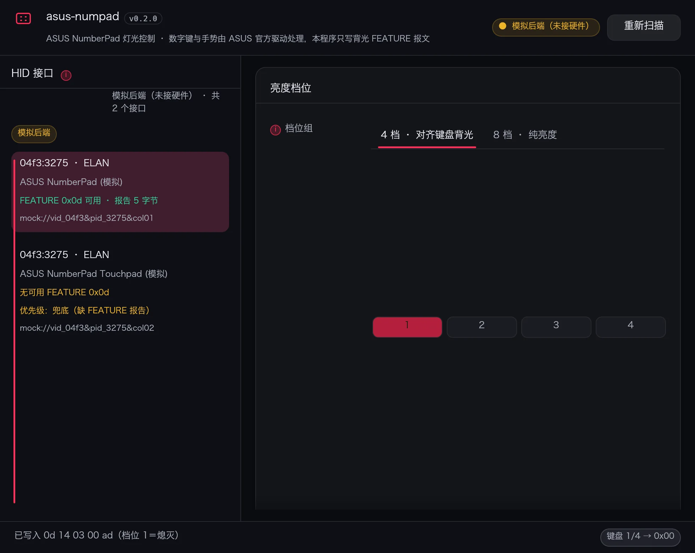
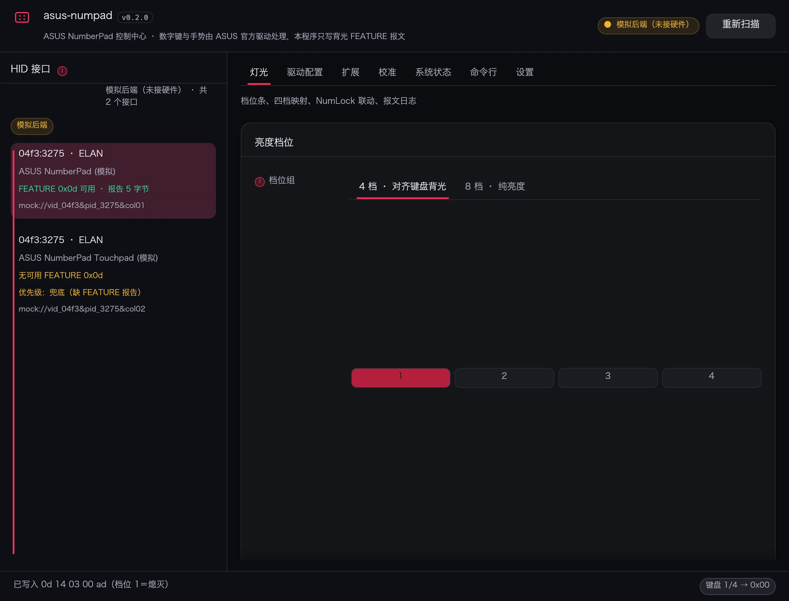
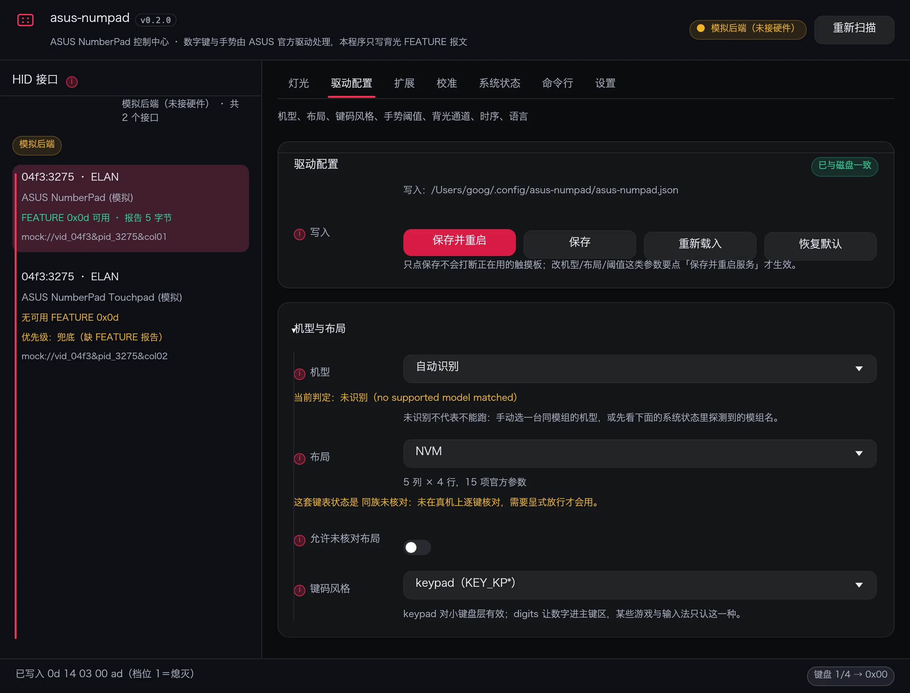

---

# numdeck-gui

ASUS 触摸板数字小键盘（NumberPad）的 **背光控制图形界面**，Windows 与 Linux 共用同一份界面代码。

## 定位与边界

Windows 侧只做灯光：向设备的 HID FEATURE 报文写入亮度命令字，键位与手势全部留给 ASUS 官方驱动。Linux 侧是一个完整的控制面板：不光调灯，还把驱动的全部调节项、服务启停与排障信息一起搬进窗口。输入侧两个平台都不碰——Linux 的输入仍由 `numdeck` 服务负责，界面只是它的配置前端（写 JSON，不发键）。

| 平台 | 数字键与手势由谁处理 | 本程序怎么点灯 |
| --- | --- | --- |
| Windows | ASUS 官方驱动（`AsusNUMPADFilter` 等） | 用户态 HID（`setupapi` + `hid.dll`）→ `HidD_SetFeature` 写 FEATURE 0x0d |
| Linux | 本仓库的 systemd 用户单元 `numdeck`（evdev + uinput） | 写 `/dev/hidrawX` 的 FEATURE 0x0d |

- 不装内核驱动，不接管键盘输入，不改变原有手感。
- 界面的设备列表、档位、报文编码、设备排序判据全部复用根 crate 的 `led_proto` / `led_policy` / `brightness`，两个平台与命令行驱动共用一套规则：同一台机器在 Windows 上选"第 2 档"、在 Linux 上选"第 2 档"，写出去的字节完全一致。
- Linux 上界面与驱动是两个独立进程：驱动管输入和跟随键盘背光，界面发一次性的亮度命令、改配置文件、启停服务。改完配置要重启服务才生效，界面上「保存并重启」一步做完。

## 界面结构

窗口右边是页签，左边始终是设备与日志。页签数量按平台决定：Windows 一页，Linux 五页。

| 页签 | 平台 | 内容 |
| --- | --- | --- |
| 灯光 | 两端 | HID 接口选择、键盘四档 → 触摸板亮度映射、点亮 / 熄灭、NumLock 联动、跟随键盘背光、报文日志 |
| 驱动配置 | 仅 Linux | 驱动配置文件的全套编辑项，见下表 |
| 系统状态 | 仅 Linux | 配置文件路径、机型、布局、背光通道、服务状态与启停；诊断信息复制 / 存盘 |
| 命令行 | 仅 Linux | `numdeck` 子命令与全局参数的图形表单 |
| 设置 | 两端 | 开机自启、启动即下发、路径与版本一览、打开设置 / 驱动配置目录 |

Windows 只有灯光这一页——那边的键位处理是官方驱动的事，不需要本程序插手：



Linux 是全套。灯光页：



驱动配置页：



「驱动配置」页按驱动配置文件（`~/.config/numdeck/numdeck.json`，root 下 `/etc/numdeck/numdeck.json`）的字段分组，改完不写盘、只在内存里攒草稿，底部按钮才落盘：

| 分组 | 可调项 |
| --- | --- |
| 机型与布局 | 机型（自动识别结果 / 手动指定）、触摸板布局、是否允许未验证布局、键码风格（数字键 / 小键盘） |
| 键盘行为 | NumLock 联动策略、混合模式、计算器手势（长按 / 关闭）、独占触摸板 |
| 背光通道与跟灯 | 通道（无 / hidraw / i2c）、hidraw 路径、i2c 总线与地址、是否跟随键盘背光、跟随轮询间隔、手动档位表（序号 + 命令字） |
| 手势与阈值 | 触摸板尺寸、各手势判定阈值与时间间隔 |
| 时序参数 | 固件帧计数类的时序常数，一般不用动 |
| 驱动语言 | 驱动与 CLI 的输出语言（界面自身语言不受影响） |
| 配置文件内容 | 与 `numdeck --dump-config` 一致的只读 JSON 预览 |

底部四个按钮：保存、保存并重启服务、重新读取、恢复默认。写盘目标取决于权限——以 root 跑就写系统路径，否则写用户级路径，界面上会标明当前目标。改这些字段等价于手改 JSON 再 `systemctl --user restart numdeck`，只是不用切终端。

## 外观

界面是「卡片 + 单一强调色」：内容按分组装进圆角卡片，卡片之间留白，页签是顶部的分段控件，
按钮只有主（实心强调色）/ 次（描边）两级，所以同一屏里哪个是可以点的主动作不需要找。

- 深浅色两套调色板都在 `gui/src/theme.rs`，跟随系统主题；`NUMDECK_GUI_THEME=dark|light`
  可强制指定，截图与交稿时用得上。
- 亮度调节不是滑块而是档位条：一格一档，点哪格就是哪档，能直接看出「一共几档、还能往哪走」。
- 颜色、圆角、间距、字号只在 `theme.rs` 里定义一次，页面代码只调 `theme::card` /
  `theme::section` / `theme::primary` 这些工具，避免各页面各写一套。

几个环境变量，方便排障与截图：

| 变量 | 作用 |
| --- | --- |
| `NUMDECK_GUI_FULL=1/0` | 强制全套 / 仅灯光界面，覆盖按平台推断的结果（Linux 上想看单灯光界面时用） |
| `NUMDECK_GUI_PAGE=light\|driver\|system\|command\|settings` | 启动时直接落在某一页 |
| `NUMDECK_GUI_SHOT=<路径>.ppm` | 渲染几帧后把窗口内容存成 PPM 并退出，无需截图工具 |
| `NUMDECK_GUI_THEME=dark\|light` | 强制深色 / 浅色，默认跟随系统（截图用） |
| `NUMDECK_GUI_SIZE=1180x1500` | 覆盖初始窗口尺寸（截整页时用） |
| `NUMDECK_GUI_HOVER=1` | 离屏截图时给 `RawInput` 塞一个不动的指针，把悬浮说明气泡一起拍下来 |
| `NUMDECK_GUI_HOVER_TEXT=<正文片段>` | 按说明正文挑控件停靠（比序号稳，段落改一个字也不至于移位） |
| `NUMDECK_GUI_HOVER_INDEX=<n>` | 按本帧绘制顺序停在第 n 个挂了说明的控件上 |

悬浮气泡那张图这么拍（气泡有 0.5 s 停留延迟，`shot.rs` 会自己推虚拟时间）：

```bash
NUMDECK_GUI_FULL=1 NUMDECK_GUI_PAGE=extend NUMDECK_GUI_SIZE=1180x1500 \
NUMDECK_GUI_HOVER=1 NUMDECK_GUI_HOVER_TEXT=贴一张小键盘贴纸 \
NUMDECK_GUI_THEME=light NUMDECK_GUI_SHOT=hover.ppm ./target/release/numdeck-gui
```

`HOVER_TEXT` / `HOVER_INDEX` 单独给也会自动开悬停，不用再补 `HOVER=1`。"

## 键盘四档 → 触摸板亮度

笔记本键盘背光通常只有四档（含灭），触摸板小键盘的背光却有 8 档（`0x41`…`0x48`）。界面把「键盘按第几档」直接对到「触摸板亮到哪个命令字」，四档一一对应，不靠用户在两套档位之间心算。

| 键盘档位 | 默认命令字 | 说明 |
| --- | --- | --- |
| 第 1 档 | `0x00` | 灭 |
| 第 2 档 | `0x43` | 3/8 |
| 第 3 档 | `0x46` | 6/8 |
| 第 4 档 | `0x48` | 8/8 |

- 逐档一个下拉，选项只有 `0x00` 与 `0x41`…`0x48`——硬件没有中间的灰度值，写别的数不会更亮，界面也不给填。
- 每行一个「试亮」按钮，发出去的就是那一档的报文，看着调而不是记数字。
- 映射要求单调不减：改出「第 3 档比第 4 档还亮」这类顺序，界面会标出冲突，但不会拦着不让存——有些机型确实需要平台特殊取值。
- 「写入驱动配置」把这张表写进驱动配置的 `manual_brightness_levels`，「从驱动配置读取」反向覆盖界面；驱动配置页的手动档位表也有对应两个按钮，两边不会各改一套。
- 切到 8 档模式时不显示这张表：8 档就是一个键盘档对一个命令字，线性等分即可。

状态栏右下角常显当前映射，例如「键盘 3/4 → 0x46」，改完点灯之前就能确认。

## 命令面板


窗口里那张「命令行」面板把 `numdeck` 的子命令逐个接进来。它不是另写一份实现：表单拼出
argv，后台跑同一个可执行文件，stdout / stderr 原样贴回输出框，面板上还显示完整的命令行，方便
复制到终端复现。CLI 加参数、改文案，界面跟着变，不存在两套逻辑各自漂移的问题。

| 子命令 | 面板里的形态 | 写配置 |
| --- | --- | --- |
| `check` | 无参数，校验配置与识别结果 | 否 |
| `dump` | 无参数，导出当前生效配置 | 否 |
| `bright` | 查看状态 / 跳到某档 / 跟随键盘背光（开、关）/ `cycle` / `up` / `down` | 否 |
| `levels` | 查看档位表 / `reset` / 改写某一档（档位 + 命令字） | 是（后两项） |
| `led` | 不带值 / `on` / `off` / 直接下发命令字 | 否 |
| `layout` | 查看已识别布局 / `--ids` / 指定布局名 | 是（指定时） |
| `sku` | 识别结果 / `list` / 手动指定 / `auto` 取消 | 是（指定时） |
| `lang` | 查看当前语言 / 指定语言代码 | 是（指定时） |

另外把全局开关也做进了面板：`--config`、`--device`、`--led`、`--hidraw`、`--i2c-*`、
`--layout`、`--sku`、`--numlock`、`--mixed-mode`、`--no-follow-brightness`、`--verbose`、
`--dump-config`、`--grab` / `--no-grab`。留空的项不会出现在命令行里，`--grab` 与 `--no-grab`
互斥时会直接拦住。

`run` 不在面板里：它是前台常驻引擎，界面上等价的入口是「系统状态」区的服务启停，参数另有去处。

几点实现上的取舍：

- **可执行文件**按 `NUMDECK_BIN` → 与 GUI 同目录 → `PATH` → 常见安装位置查找。找不到时
  面板顶部直接说明，不会静默失败。
- **超时**：`dump` 在 CLI 里是「一直打印直到 Ctrl+C」，面板给它 5 秒上限。到时杀掉进程并把
  已经打印的部分交回来；读输出走的是分块读取，所以即使有别的进程继承了 stdout，也不会把界面
  卡在「执行中」。
- **写配置的按钮标黄**，执行结束后界面自动重读机型、布局、档位、语言，不需要手动刷新。

## 协议

FEATURE report 长度 5 字节：

```
0d 14 03 <level> ad
```

| `level` | 含义 |
| --- | --- |
| `0x00` | 熄灭 |
| `0x01` | 普通点亮（保持当前档） |
| `0x41` … `0x48` | 亮度档（由暗到亮） |

该报告 write-only，写完不能回读，所以界面的"当前档位"以本地记录为准，不反映其它程序（键盘快捷键、`numdeck` 服务）刚做过的改动——下次点灯时会被界面覆盖回来，这是预期行为。

一台机器上通常有多个 HID 接口，只有带 FEATURE 0x0d 的那个能点灯。已知受支持的 PID 见 `src/led_policy.rs` 的 `KNOWN_NUMPAD_PIDS`（`0x3275` 等 ELAN 触摸板）。

## 构建

两个平台都是同一个 crate：

```bash
cargo build --release -p numdeck-gui
```

Windows（本机）：产物 `target\release\numdeck-gui.exe`，无需 MinGW；首次构建要联网拉 `eframe` 与 `windows`。

Linux：

```bash
sudo dnf install gcc pkgconf          # Fedora
sudo apt install build-essential pkg-config   # Debian/Ubuntu
cargo build --release -p numdeck-gui      # 产物 target/release/numdeck-gui
```

`eframe` 的 x11 / wayland 后端通过 dlopen 访问系统库，构建期不需要 X11 头文件；运行期需要 OpenGL（Mesa 或厂商驱动）、`libxkbcommon`，以及一个 X11 或 Wayland 会话。界面从系统字体里找中文字体（Noto Sans CJK / 文泉驿微米黑等），都没有时中文会显示成方块，功能不受影响。

在别的平台上只做类型检查：

```bash
rustup target add x86_64-unknown-linux-gnu x86_64-pc-windows-gnu
cargo check -p numdeck-gui --target x86_64-unknown-linux-gnu
cargo check -p numdeck-gui --target x86_64-pc-windows-gnu
```

`check` 不链接，因此不需要目标平台的头文件和链接器，适合在 macOS / Linux 上验证另一端的代码是否类型正确。

## 使用

直接运行二进制即为图形界面。左侧常驻：

| 区域 | 内容 |
| --- | --- |
| 设备接口 | 枚举到的 HID 接口，标注是否带 FEATURE 0x0d，`pick_best` 预先选好一个 |
| 报文日志 | 每次写入的时间、接口、5 字节报文与返回值 |

右侧按页签切换，见上面的「界面结构」。灯光页的档位滑条里 1 档即熄灭。

Linux 的"系统状态"区就是排查入口：灯不亮时先看这里——机型没认出来会在提示里说清楚是配置没写还是 DMI 没命中，背光通道缺失会提示检查 udev 规则。要发出去问人时点一下"复制诊断信息"，内容与 `--selftest` 打印的一致（平台状态 + 接口列表 + 8 档报文），点"保存诊断报告"则写到设置目录下的 `diag-<时间戳>.txt`。

命令行：

| 参数 | 作用 |
| --- | --- |
| `--selftest` | 打印平台状态、接口列表、档位表与每档对应报文，不写硬件。界面上等价于「系统状态」页的**复制诊断信息 / 保存诊断报告** |
| `--on` | 点亮到默认档位 |
| `--off` | 熄灭 |
| `--level <n>` | 指定档位，十进制或 `0x` 十六进制均可 |
| `--apply-startup` | 供开机自启调用，静默写入一次灯光状态 |

设置文件（只存界面自己的选择，与驱动的 `numdeck.toml` 无关）：

| 平台 | 路径 |
| --- | --- |
| Windows | `%APPDATA%\numdeck-gui\settings.json` |
| Linux | `~/.config/numdeck-gui/settings.json` |

字段：档位数、当前档位、是否跟随 NumLock、轮询间隔（100–5000 ms）、上次选中的接口路径、启动时是否立即应用，以及四档映射表 `kbd_map`（四个命令字，见下节）。

开机自启：

- Windows：写 `HKCU\Software\Microsoft\Windows\CurrentVersion\Run` 下的字符串值 `AsusNumpadGui`，命令行是当前 exe 加 `--apply-startup`。不需要管理员权限，删掉该值即关闭。
- Linux：不写 autostart 文件，界面里的"开机自启"就是 `systemctl --user enable numdeck`——开机要点的是**驱动**的灯，界面本身不必常驻。想连界面一起启动，自己在桌面环境的自启动项里加 `numdeck-gui --apply-startup`。

## 常见问题

- **Linux 上"未找到可用接口"**：先确认 `/dev/hidraw*` 里能看到触摸板，再确认 udev 规则已生效（`packaging/` 里那份 70- 前缀规则，`udevadm control --reload-rules && udevadm trigger --subsystem-match=hidraw`）。规则没生效时普通用户打不开 hidraw，界面会提示权限不足。
- **Linux 上写入返回成功但灯不变**：多半选错了接口，改选列表里 `feature=true` 的那一项；也可能是 `numdeck` 服务正按键盘背光联动，两边在抢同一个通道，先停服务再试。
- **Windows 上写入成功但灯不变**：同上，改选带 FEATURE 0x0d 的接口。
- **跟随 NumLock 无效**：Windows 走 `GetKeyState(VK_NUMLOCK)` 轮询，Linux 读 `/sys/class/leds/*::numlock/brightness`；外接键盘或 OEM 定制布局可能改写语义，此时关掉联动手动选档。Linux 上如果更在意"跟随键盘背光"，用驱动服务自带的联动，不要开这个开关。
- **界面中文是方块**：系统里没装中文字体，装 `fonts-noto-cjk`（Debian/Ubuntu）或 `google-noto-sans-cjk-fonts`（Fedora）后重启界面。
